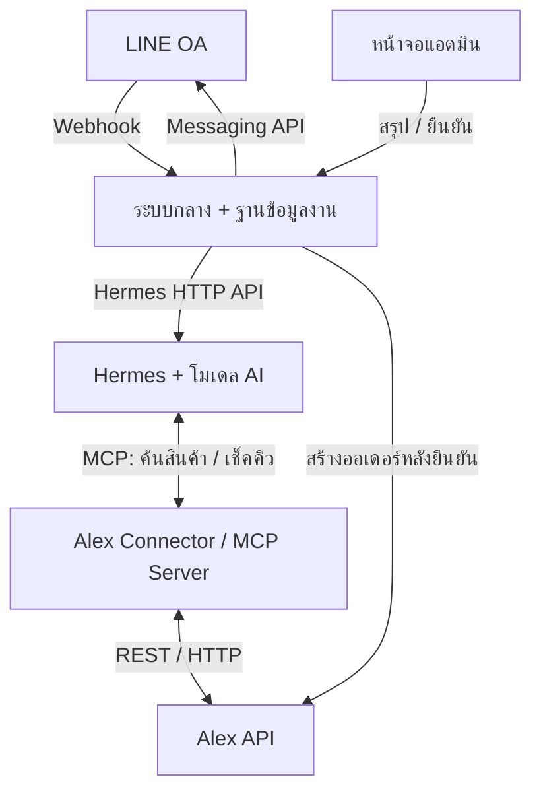
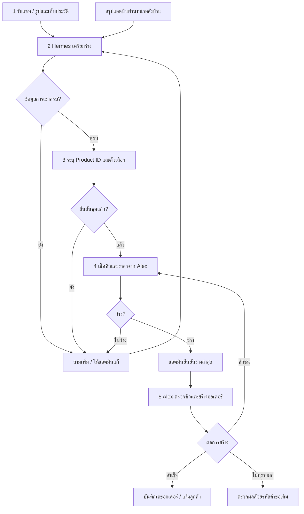

# Alex Rental × LINE OA × Hermes Agent

## คู่มือออกแบบระบบรับ inquiry และเปิดออเดอร์เช่า

วันที่จัดทำ: 21 ตุลาคม 2569 (2026-10-21) · ปรับปรุง: 24 ตุลาคม 2569 (2026-10-24) · เวอร์ชัน 1.4

**สถานะเอกสาร:** ตรวจโค้ด client เดิมใน `billing_wth_text/` แล้ว พบวิธี login, ค้นสินค้า, เช็คคิว และ submit order ผ่าน Alex API ตามหัวข้อ 10.5 การตรวจครั้งนี้อ่านโค้ดและทดสอบด้วย mock ไม่ได้เรียก API production หรือสร้างออเดอร์จริง ยังต้องยืนยัน response ของการสร้างออเดอร์, กติกาคิว, atomicity และ idempotency กับฝั่ง Alex ส่วนชื่อ MCP tools และ data contract กลางยังเป็นแบบที่เสนอสำหรับระบบใหม่

**เริ่มอ่านการเชื่อม API:** ใช้หัวข้อ [10.5 วิธีเรียก Alex API จากโปรแกรมเดิม](#legacy-alex-api) สำหรับ raw request จริงที่ client เดิมสร้าง ส่วนหัวข้อ 10.1–10.3 เป็นข้อมูลภายใน Connector ต้องแปลงก่อนส่ง Alex

**แนวทางเริ่มต้น:** ให้ Hermes อ่านแชทและรูป เตรียมร่าง ค้นสินค้า และเช็คคิว จากนั้นแอดมินตรวจและยืนยัน ระบบกลางจึงเรียก Alex API เพื่อสร้างออเดอร์

**จุดที่ใช้ MCP:** ระหว่าง Hermes กับ Alex Connector โดยเฉพาะ Step 3–4 ส่วน LINE webhook และการ submit โดยระบบกลางใช้ HTTP/REST ตาม API ของบริการนั้นได้โดยตรง

## 1. เป้าหมายและผลลัพธ์ของระบบ

ระบบนี้ช่วยเปลี่ยนข้อมูลที่กระจัดกระจายในแชท LINE และสรุปจากแอดมิน ให้เป็นข้อมูลออเดอร์เช่าที่ตรวจสอบได้ ลดการคัดลอกข้อมูล และใช้คิวจริงจาก Alex ก่อนรับจอง

| ขั้นตอน | สิ่งที่ระบบทำ | ผลลัพธ์ที่ต้องได้ |
| --- | --- | --- |
| 1. รับ inquiry | รับข้อความและรูปจาก LINE OA แล้วเก็บประวัติ | ข้อมูลต้นทางพร้อม customer/conversation/inquiry reference |
| 2. สรุปร่างออเดอร์ | รวมแชทกับสรุปแอดมิน สกัดรายละเอียดการเช่า | ร่างที่แก้ไขได้ พร้อมรายการข้อมูลที่ขาดหรือขัดกัน |
| 3. ระบุสินค้า | จับคู่รหัส ลิงก์ หรือรูป กับแค็ตตาล็อก Alex | Product ID และตัวเลือก/ชุดรายตัวที่ยืนยันแล้ว |
| 4. เช็คคิวและราคา | ใช้ Alex API ตรวจช่วงเช่าและเงื่อนไขราคา | ผลคิว ณ เวลาที่ตรวจ และใบเสนอราคาหรือข้อมูลราคา |
| 5. สร้างออเดอร์ | แอดมินยืนยัน ระบบตรวจและบันทึกผ่าน Alex API | ออเดอร์จริงพร้อมเลขอ้างอิง และผลแจ้งลูกค้า |

ออเดอร์จริง คิวจริง และสถานะการชำระเงินจริงต้องอ้างอิง Alex หรือระบบที่ร้านกำหนด AI มีหน้าที่ช่วยตีความและเรียกเครื่องมือ ไม่ตัดสินว่าชำระเงินแล้วจากข้อความสนทนาเพียงอย่างเดียว

## 2. Component และเจ้าของความรับผิดชอบ

| Component | รับอะไร | ทำอะไร | ส่งอะไร / ติดต่อใคร |
| --- | --- | --- | --- |
| ลูกค้า | คำถามหรือข้อเสนอจากร้าน | แจ้งชุด วันที่ และข้อมูลที่จำเป็น | ข้อความ รูป หรือการเลือกผ่าน LINE |
| LINE OA / Messaging API | ข้อความและการกระทำของลูกค้า | ส่ง webhook และรับคำขอส่งข้อความกลับ | ติดต่อระบบกลางผ่าน webhook/HTTP API |
| ระบบกลางสำหรับงานจอง | webhook, สรุปแอดมิน, ผลจาก Hermes และ Alex | เก็บงาน แยก inquiry คุมสถานะ ตรวจสิทธิ์ และประสานขั้นตอน | เรียก Hermes, Connector, Alex และบริการส่งข้อความ |
| ฐานข้อมูลบทสนทนาและร่าง | ข้อความ เหตุการณ์ ร่าง และเวอร์ชัน | เก็บข้อมูลระหว่างงานและหลักฐานการเปลี่ยนแปลง | ส่งบริบทที่เกี่ยวข้องให้ระบบกลาง |
| ที่เก็บรูป / ดัชนีสินค้า | รูปลูกค้า รูปแค็ตตาล็อก และ mapping | จัดเก็บไฟล์และช่วยค้นรายการที่ใกล้เคียง | คืน media reference หรือ product candidates |
| Hermes + โมเดล AI | บริบทที่คัดเลือกแล้วและสถานะงาน | สรุป สกัดข้อมูล เสนอคำถาม และเลือกเรียก tools | ส่งข้อมูลแบบมีโครงสร้างและผลวิเคราะห์กลับ |
| Alex Connector / MCP Server | tool calls จาก Hermes หรือคำขอจากระบบกลาง | ตรวจ schema/สิทธิ์ แปลงข้อมูล และเรียกบริการปลายทาง | เรียก Alex REST API หรือบริการค้นภาพ |
| Alex Backend / API | คำขอค้นสินค้า เช็คคิว คิดราคา และสร้างออเดอร์ | ใช้กติกาธุรกิจของ Alex และบันทึกข้อมูลจริง | คืนสินค้า คิว ราคา Order ID และสถานะ |
| หน้าจอแอดมิน | แชท ร่าง ผลจับคู่สินค้า และผลตรวจคิว | ให้คนแก้ไข เลือกชุด ตรวจราคา และยืนยัน | ส่งการตัดสินใจที่ผูกกับผู้ใช้และเวอร์ชันร่าง |

Alex Connector สามารถเป็นบริการเดียวที่เปิดทั้ง MCP tools และ internal HTTP handlers ได้ ไม่จำเป็นต้องสร้างเป็นสองระบบแยกกัน อย่างไรก็ตาม การแยกสิทธิ์อ่านข้อมูลกับสิทธิ์สร้างออเดอร์ต้องบังคับได้จริง



Hermes รองรับ API Server สำหรับรับงานจากโปรแกรมภายนอก และรองรับ MCP สำหรับเชื่อมเครื่องมือภายนอก ทั้งสองส่วนมีหน้าที่และทิศทางการเรียกต่างกัน [S1][S2]

## 3. Flow รวมและจุดตัดสินใจ



คำว่า **ว่าง** ใน Step 4 หมายถึงผลตรวจ ณ ขณะนั้น การจองสำเร็จต้องรอผลจากขั้นตอนบันทึกและกันคิวใน Alex การแจ้งลูกค้าและการสร้างออเดอร์เป็นคนละงาน หากส่งข้อความไม่สำเร็จ ต้อง retry เฉพาะข้อความ

## 4. Step 1 — รับ inquiry จาก LINE OA

**Input:** ข้อความ รูป วันที่ การตอบกลับ หรือการกดปุ่มของลูกค้า

**เจ้าของงานหลัก:** LINE OA → ระบบกลาง → ฐานข้อมูลบทสนทนา / ที่เก็บรูป

1. เปิด Messaging API และตั้ง webhook URL แบบ HTTPS ของระบบกลาง
2. ระบบกลางตรวจลายเซ็น webhook จาก raw request body ก่อนประมวลผล
3. ตรวจ `webhookEventId` เพื่อป้องกันการประมวลผลเหตุการณ์ซ้ำ
4. บันทึกเหตุการณ์ลง MongoDB และ upsert ผู้ใช้จาก `source.userId` ลง `line_users` ก่อนตอบรับ webhook จากนั้นให้ worker ประมวลผลต่อ
5. บันทึกข้อความ text ที่ได้รับทันทีใน `line_events` และผูกประวัติกับ LINE user ID ของผู้ส่ง สำหรับรูปให้ใช้ message ID ดาวน์โหลดและเก็บ media reference ตามนโยบายที่กำหนด
6. ผูกเหตุการณ์กับร้าน ลูกค้า บทสนทนา และ inquiry ปัจจุบัน หากมีหลายเรื่องที่ยังเปิดอยู่และไม่ชัดว่าเป็นเรื่องใด ให้แอดมินเลือกหรือถามเพิ่ม
7. เรียงบริบทตามเวลาที่เกิดเหตุการณ์ และรวมข้อความที่ส่งติดกันตามช่วงเวลาที่ตั้งค่าได้ ก่อนส่งให้ Hermes วิเคราะห์

LINE แนะนำการประมวลผล webhook แบบ asynchronous ข้อความ text ต้องเก็บจาก webhook เพราะไม่มี API ให้เรียกข้อความนั้นกลับมาอ่านอีก ส่วนเนื้อหาไฟล์ที่ผู้ใช้ส่งมีระยะเวลาจัดเก็บจำกัด [S3]

| ข้อมูลขั้นต่ำ | วัตถุประสงค์ |
| --- | --- |
| ShopInfoId / tenant reference | จำกัดข้อมูลให้อยู่ในร้านที่ได้รับสิทธิ์ |
| LINE channel reference | แยก OA และข้อมูลรับส่งของแต่ละช่องทาง |
| LINE user ID | อ้างอิงผู้ส่งในบริบทช่องทางนั้น ไม่ใช้ชื่อแสดงผลเป็นตัวระบุหลัก |
| Conversation ID | เก็บบริบทสนทนา |
| Inquiry ID | แยกการจองแต่ละครั้งของลูกค้าคนเดิม |
| webhookEventId / message ID | กันเหตุการณ์ซ้ำ และอ้างอิงข้อความหรือรูป |
| event timestamp / received timestamp | รองรับเหตุการณ์ที่มาถึงไม่เรียงเวลา |
| message type / text / media reference | เนื้อหาสำหรับวิเคราะห์ |

**Output:** ประวัติข้อความและรูปที่มีรหัสอ้างอิง พร้อมงานให้ Hermes ประมวลผล

**กรณีเพิ่มเติม:** LINE อาจส่งเหตุการณ์ซ้ำหรือส่งไม่เรียงตามลำดับเดิม และการ redelivery ไม่ใช่หลักประกันว่าจะได้รับทุกเหตุการณ์ จึงต้องมี log และการแจ้งเตือนช่องทางรับข้อมูล [S3]

<a id="step1-user-history"></a>

### 4.1 เก็บ LINE user ID และประวัติแชทใน MongoDB

เมื่อได้รับ webhook ที่ตรวจลายเซ็นและ OA ปลายทางผ่านแล้ว ระบบจะเก็บ `source.userId` โดยอัตโนมัติ รวมถึงเหตุการณ์เพิ่มเพื่อน (`follow`), ข้อความ และ postback ที่มี user ID ตาม [คู่มือรับ webhook](https://developers.line.biz/en/docs/messaging-api/receiving-messages/) และ [คู่มือรับ user ID](https://developers.line.biz/en/docs/messaging-api/getting-user-ids/) ของ LINE ผู้ใช้ไม่ต้องกรอก LINE user ID เอง และระบบไม่ใช้ชื่อแสดงผลหรือ LINE ID ที่ใช้ค้นหาเพื่อนมาแทน `source.userId`

| Collection | ข้อมูลและวิธีผูกกัน |
| --- | --- |
| `line_users` | ทะเบียนผู้ใช้หนึ่งรายการต่อ `(shop_id, channel_id, line_user_id)` มี `_id`, `created_at`, `updated_at`, `first_seen_at`, `last_seen_at`; เวลา first/last อิง timestamp ของเหตุการณ์ |
| `line_events` | ประวัติข้อความและ postback แต่ละรายการ เก็บผู้ส่งที่ `payload.source.userId` พร้อมข้อความต้นฉบับ เวลา สถานะงาน และ media reference โดยไม่คัดลอกข้อความซ้ำลงทะเบียนผู้ใช้ |
| `conversations` / `inquiries` | ผูกงานจองกับผู้ส่ง โดยยังแยกแชทส่วนตัว กลุ่ม ห้อง และผู้ส่งแต่ละคนในกลุ่ม |

การเพิ่มเพื่อนอย่างเดียวยังไม่สร้าง inquiry ส่วนข้อความจะเข้าสู่ขั้นตอนผูก inquiry ตามเดิม ทะเบียนผู้ใช้และข้อความไม่เพิ่มซ้ำเมื่อ LINE ส่งเหตุการณ์เดิมมาอีก และเวลา first/last ไม่ถอยผิดเมื่อเหตุการณ์มาถึงสลับลำดับ หากบันทึกทะเบียนผู้ใช้ไม่สำเร็จ ระบบตอบ 503; การส่งซ้ำจะเติมทะเบียนที่ค้างโดยไม่สร้างข้อความเดิมเพิ่ม

**API ดูข้อมูลที่เพิ่มแล้ว:** ทุก endpoint ต้องใช้ `Authorization: Bearer <INQUIRY_ADMIN_TOKEN>` และจำกัดร้าน/ช่องทางตาม config

| Method / path | ผลลัพธ์ |
| --- | --- |
| `GET /api/line/users` | `{ "users": [...], "next": "..." }` ล่าสุด 100 ผู้ใช้; ใช้ `?before=<next>` อ่านหน้าถัดไป |
| `GET /api/line/users/{line_user_id}/messages` | `{ "line_user_id": "...", "messages": [...], "next": "..." }` สูงสุด 200 รายการ เรียง `event_at`, `event_id`; ใช้ `?after=<next>` อ่านต่อ |

ตัวอย่าง PowerShell สำหรับเครื่องแอดมิน: คัดลอกค่า `INQUIRY_ADMIN_TOKEN` จาก `.env` ของระบบมากรอกในช่องรับค่าแบบซ่อน ระบบไม่ได้โหลด `.env` เข้า PowerShell ให้อัตโนมัติ

```powershell
& {
    $secureToken = Read-Host "INQUIRY_ADMIN_TOKEN" -AsSecureString
    $credential = [System.Management.Automation.PSCredential]::new("admin", $secureToken)
    $headers = @{ Authorization = "Bearer " + $credential.GetNetworkCredential().Password }
    $users = Invoke-RestMethod "http://127.0.0.1:8080/api/line/users" -Headers $headers
    $users.users | Select-Object line_user_id, first_seen_at, last_seen_at
    $firstUser = $users.users | Select-Object -First 1
    if ($null -ne $firstUser) {
        $userId = [Uri]::EscapeDataString($firstUser.line_user_id)
        Invoke-RestMethod "http://127.0.0.1:8080/api/line/users/$userId/messages" -Headers $headers |
            ConvertTo-Json -Depth 20
    }
}
```

ประวัติรายคนแสดงเฉพาะข้อความและ postback ของคนนั้นที่ระบบได้รับ ทั้งแชทส่วนตัวและข้อความของเขาในกลุ่ม โดยดูแหล่งแชทจาก `payload.source` ได้ ข้อความที่ยังรอ worker, `FAILED` หรือ `NEEDS_ADMIN` ก็ดูได้ ข้อความถูก unsend จะเหลือ metadata พร้อม `withdrawn: true` และซ่อนเนื้อหา/ลิงก์รูปตั้งแต่รับเหตุการณ์ยกเลิกส่ง ส่วนการอ่านรูปยังผ่าน API ภายในตามสิทธิ์และอายุจัดเก็บเดิม

**ขอบเขตปัจจุบัน:** เริ่มเก็บผู้ใช้จาก webhook ที่ได้รับหลังเปิดใช้โค้ดนี้ ผู้ใช้เก่าจะมีทะเบียนเมื่อส่งเหตุการณ์ใหม่ ส่วนข้อความเดิมที่มี `payload.source.userId` อยู่แล้วเรียกดูด้วย user ID นั้นได้ ไม่ได้ดึงประวัติแชทเก่าย้อนหลังจาก LINE หรือรวมข้อความที่แอดมินพิมพ์ใน OA Manager ให้อัตโนมัติ และยังไม่มีหน้าจอ inbox ในงานนี้ เหตุการณ์ที่ไม่มี `source.userId` ยังถูกเก็บไว้ให้ตรวจ แต่ไม่สร้างผู้ใช้สมมติขึ้นมา

<a id="step1-server-deploy"></a>

### 4.2 Build บน local แล้ว deploy Linux release บน Ubuntu

**ผู้พัฒนา:** compile/build โปรแกรมบนเครื่อง local เท่านั้น เปิด Docker Desktop (Linux containers) แล้วรัน `build-line.bat` เพื่อสร้าง Linux/amd64 binary ใน `dist/line-linux/` และ archive `dist/line-rel-<เวลา UTC>-<hash>.tar.gz` สำหรับส่งมอบ ไม่ใช้ Windows `.exe` กับ Ubuntu

**ผู้ดูแลระบบ:** รับและแตก archive ลง `/home/ubuntu/alex-order-connector` ตั้ง `.env` ของ server แล้วรัน:

```sh
cd /home/ubuntu/alex-order-connector
sudo bash ./deploy-line.sh --init-swarm
```

สคริปต์ตรวจ checksum/ชนิด binary แล้ว COPY release ที่ build มาแล้วเข้า Docker runtime image จากนั้น deploy backend และ MongoDB ด้วย `docker-stack.line.yml` **ไม่มีการ compile Rust หรือ build frontend บน Ubuntu** ถ้า release ขาดจะหยุดให้ผู้พัฒนาสร้างบน local ก่อน

ครั้งถัดไปส่ง archive รุ่นใหม่แล้วรัน `sudo bash ./deploy-line.sh` เมื่อเห็น `[OK] Backend is healthy` จึงตั้ง LINE Webhook URL เป็น `https://hermes.salepie.online/api/line/webhook` กด Verify และเปิด Use webhook เส้นทาง Caddy นี้ส่งต่อ backend พอร์ต 18080 ส่วนเส้นทางอื่นใช้ Hermes เดิมพอร์ต 8646

ดูคำสั่ง build local, ส่งไฟล์, config, Caddy และตรวจรับใน [คู่มือส่ง release ไป deploy บน server](docs/deploy-line-server.md) หลัง deploy ไม่ต้องเปิดคอม local หรือ SSH tunnel ค้างไว้ `runall.bat` ใช้พัฒนา/ทดสอบบน Windows

## 5. Step 2 — รวมสรุปแอดมินและสกัดร่างออเดอร์

**Input:** แชทที่เกี่ยวข้อง รูป สรุปแอดมิน ร่างก่อนหน้า และการยืนยันล่าสุด

**เจ้าของงานหลัก:** ระบบกลาง → Hermes → ตัวตรวจสอบข้อมูล → ฐานข้อมูลร่าง

### 5.1 ช่องทางรับสรุปจากแอดมิน

แนวทางเริ่มต้นคือเพิ่มปุ่ม **เตรียมออเดอร์ด้วย AI** ในหน้าหลังบ้าน แอดมินเลือก inquiry วางข้อความสรุป แล้วส่งให้ AI ช่วยจัดรูปแบบ ตัวอย่าง:

> คุณเอ เช่าชุด DR-012 สีแดง ไซซ์ M รับวันที่ 15 พ.ย. 2569 คืนวันที่ 18 พ.ย. 2569 ค่าเช่า 1,500 บาท มัดจำ 2,000 บาท รับหน้าร้านสาขา A

Webhook มาตรฐานของ LINE ระบุการรับข้อความจากผู้ใช้ จึงไม่ควรออกแบบโดยสมมติว่าคำตอบที่แอดมินพิมพ์ผ่าน OA Manager จะเข้ามาใน webhook ของเราด้วย ต้องทดสอบช่องทางใช้งานจริง และจัดให้มีช่องทางรับสรุปแอดมินแยกต่างหาก [S3]

ทางเลือกต่อไปคือให้แอดมินตอบผ่านหน้าจอ inbox ของเรา เมื่อส่งผ่าน Messaging API ระบบจะบันทึก outbound message เองได้ หรือเชื่อม CRM ที่มี API/export สำหรับข้อมูลนั้นอย่างชัดเจน

### 5.2 หน้าที่ของ Hermes

- แยก intent ว่าลูกค้าสอบถามความว่าง ขอราคา ต้องการจอง เปลี่ยนรายละเอียด หรือยกเลิกความสนใจ
- สกัดรหัสชุด สี ไซซ์ จำนวน วันใช้ วันรับ วันคืน สาขา วิธีรับ และข้อมูลลูกค้าที่จำเป็น
- แยกค่าที่มาจากลูกค้า ค่าที่แอดมินสรุป และค่าที่ระบบ Alex ยืนยัน
- ระบุข้อมูลที่ยังขาดหรือขัดกัน แทนการเติมค่าที่ไม่มีหลักฐาน
- ส่งร่างแบบมีโครงสร้างเพื่อให้ระบบตรวจ schema ก่อนบันทึก
- เสนอคำถามสั้น ๆ เฉพาะข้อมูลที่จำเป็นต่อขั้นถัดไป

### 5.3 การจัดการข้อมูลขัดกันและวันที่

| สถานการณ์ | พฤติกรรมที่เสนอ |
| --- | --- |
| ลูกค้าบอกใช้วันที่ 16 แต่แอดมินสรุปรับวันที่ 15 | แยกวันใช้งานกับวันรับ ไม่ถือว่าเป็นวันเดียวกัน |
| ลูกค้าส่งวันใหม่หลังแอดมินยืนยัน | เปลี่ยนเวอร์ชันร่าง ยกเลิกผลยืนยันเดิม แล้วเช็คคิวใหม่ |
| ข้อความว่า “ศุกร์หน้า” หรือ “15–18 นี้” | เสนอวันที่เต็มพร้อมปีให้ยืนยัน หากยังตีความได้หลายแบบ |
| ข้อความใช้ปี 69 | แปลงเป็นวันที่มาตรฐานหลังยืนยันบริบทปี พ.ศ. ไม่เดาปีโดยไร้บริบท |
| ช่วงคืนก่อนช่วงรับ | validator ปฏิเสธและขอแก้ไข |
| ราคาที่แอดมินสรุปไม่ตรงกับ Alex | แสดงส่วนต่างและรอผู้มีสิทธิ์อนุมัติ ห้าม AI เลือกส่วนลดเอง |

เก็บวันที่ธุรกิจเป็นวันที่ตาม Asia/Bangkok หาก API ใช้วันอย่างเดียวให้ใช้ ISO date หากต้องใช้เวลาจริงให้ระบุ timezone/offset ชัดเจน การตรวจรูปแบบและแปลงวันที่ขั้นสุดท้ายควรทำด้วยโค้ดที่ตรวจสอบได้

**Output:** ร่างออเดอร์ที่ยังแก้ไขได้ พร้อม `missing_fields`, `conflicts`, แหล่งที่มาของข้อมูล และ `draft_version`

## 6. Step 3 — ระบุ Product ID และชุดที่จะเช่า

**Input:** product code, product URL, รูป หรือคำบรรยายชุด

**เจ้าของงานหลัก:** Hermes → Alex MCP Server → แค็ตตาล็อก Alex / บริการค้นภาพ → ผู้ยืนยัน

| ข้อมูลที่มี | วิธีค้น | สิ่งที่ต้องยืนยัน |
| --- | --- | --- |
| รหัสสินค้า | ค้นรหัสแบบตรงตัวภายในร้านที่ได้รับสิทธิ์ | Product ID, สาขา และตัวเลือก |
| ลิงก์สินค้า | แปลงลิงก์ที่อนุญาตเป็นรหัส แล้วค้นยืนยันในแค็ตตาล็อก | รายการนั้นยังมีอยู่และเปิดให้เช่าหรือไม่ |
| รูปที่มีรหัส | อ่านรหัสจากภาพ แล้วค้นตรงตัว | ตัวอักษรที่อ่านอาจคลาดเคลื่อน จึงต้องเทียบรายการจริง |
| รูปไม่มีรหัส | ค้นรูปใกล้เคียงและคืนหลาย candidate | ให้คนเลือกจากรูป รหัส สี และไซซ์ |
| คำบรรยาย เช่น ชุดแดงเปิดไหล่ | ค้นชื่อ/คุณลักษณะร่วมกับภาพถ้ามี | ยังไม่ใช้คำบรรยายเป็น Product ID ที่แน่นอน |

### 6.1 สิ่งที่ต้องเตรียมสำหรับการค้นภาพ

- รูปแค็ตตาล็อกที่เชื่อมกับ Product ID และ product code ของ Alex
- mapping สี ไซซ์ สาขา และชุดรายตัวตามโมเดลข้อมูลจริง
- กระบวนการอัปเดตดัชนีเมื่อสินค้าเพิ่ม เปลี่ยนรูป ย้ายสาขา หรือเลิกให้เช่า
- บริการค้นภาพ เช่น image embedding / visual similarity และการกรองตามร้าน
- หน้าจอแสดง candidate พร้อมรูปและรหัสให้ยืนยัน

คะแนนความคล้ายใช้จัดลำดับรายการ ไม่ใช่หลักฐานว่าตรงกับสินค้าชิ้นนั้นแน่นอน โดยเฉพาะภาพชุดที่ทรงและสีคล้ายกัน MCP มีหน้าที่เปิดให้เรียกบริการค้นภาพ ไม่ได้สร้างความสามารถค้นภาพขึ้นมาเอง

### 6.2 ระดับรหัสที่ต้องตรวจสอบกับ Alex

| ระดับ | ตัวอย่างสมมติ | ความหมาย |
| --- | --- | --- |
| Product | P-001 / DR-012 | แบบชุดหรือรายการสินค้า |
| Variant | V-RED-M | สีแดง ไซซ์ M ถ้า Alex แยกเป็น variant |
| Rental item / asset | ITEM-0007 | ชุดตัวจริงแต่ละตัว ถ้า Alex คุมคิวรายชิ้น |
| Branch | BR-A | สาขาที่ถือครองหรือให้เช่า |

หาก Alex ใช้ Product ID แทนชุดรายตัวอยู่แล้ว ไม่ต้องเพิ่มรหัสซ้ำโดยไม่จำเป็น ต้องตรวจว่า API เช็คคิวใช้รหัสระดับใด

**ข้อมูลจากโปรแกรมเดิม:** `POST /api/v2/GetProductItems` คืนรายการใน `itemList` และ client ใช้ `productItemId` จากรายการนั้นส่งต่อทั้ง `checkq` และ `AddRentalOrder` จึงใช้รหัสนี้เป็นจุดเชื่อมหลักได้แล้ว แต่ความหมายว่าเป็นแบบชุด ตัวเลือก หรือชุดรายตัวยังต้องยืนยันกับ Alex ดู payload ในหัวข้อ 10.5

**Output:** ตัวระบุสินค้าที่ตรงกับ API จริง พร้อมผู้ยืนยัน วิธีจับคู่ และรายการหลักฐาน

## 7. Step 4 — เช็คคิวและราคา

**Input:** สินค้าที่ระบุแล้ว ตัวเลือก/ชุดรายตัว สาขา วันรับ วันคืน และจำนวน

**เจ้าของงานหลัก:** Hermes → เครื่องมือ MCP → Alex Connector → Alex API

1. ระบบตรวจว่าข้อมูลจำเป็นครบ และสินค้ายังอยู่ในขอบเขตร้าน/สาขาที่อนุญาต
2. Hermes เรียก `check_availability` ด้วยข้อมูลมาตรฐาน
3. Connector แปลงเป็น request ตาม Alex API และส่ง credentials จากฝั่ง server
4. Alex ใช้กติกาธุรกิจจริงตรวจคิวและจำนวนที่รองรับ
5. ระบบขอราคาจาก Alex ผ่าน API ที่มีอยู่ หรือแจ้งว่าต้องเพิ่ม API สำหรับคำนวณราคา
6. บันทึกผลตรวจ เวลา เวอร์ชันร่าง และ quote reference ถ้ามี
7. ถ้าว่าง ให้แสดงสรุปเพื่อยืนยัน ถ้าไม่ว่าง ให้ค้นวัน/ชุดทางเลือกและเช็คใหม่ ถ้า API ผิดพลาดให้แสดงว่า “ยังตรวจไม่ได้”

### 7.1 กติกาคิวที่ต้องตกลง

- ใช้วันรับ–คืน หรือมีเวลา cutoff ภายในวัน
- รวมวันขนส่ง ซัก ซ่อม และเตรียมชุดอย่างไร
- วันคืนกับวันรับใหม่ซ้อนวันกันได้หรือไม่
- สถานะออเดอร์ใดกันคิว และสถานะใดปล่อยคิว
- การจองชั่วคราวหมดอายุเมื่อไร ถ้ามีระบบ hold
- คุมจำนวนรวม หรือคุมชุดรายตัว และคิวข้ามสาขาจัดการอย่างไร

### 7.2 ราคาและเงินมัดจำ

ตัวอย่างเดียวกันตลอดเอกสาร: ค่าเช่า 1,500 บาท เงินมัดจำ 2,000 บาท รวมยอดที่เรียกเก็บก่อนหักยอดชำระเดิมและรายการอื่น 3,500 บาท ต้องแยก field ค่าเช่ากับเงินมัดจำ และใช้สูตร/ภาษี/ส่วนลดตาม Alex จริง

**ข้อกำหนด:** ห้ามนำผล cache เก่าหรือค่าจากความจำของ AI มาแจ้งเป็นผลคิวปัจจุบัน ผลเช็คคิวไม่ใช่การกันคิว และการเช็คซ้ำก่อน submit เพียงอย่างเดียวยังไม่ป้องกันการแข่งขันจองพร้อมกัน ต้องมีการตรวจและจองแบบ atomic ในขั้นบันทึก

**Output:** ผลว่าง/ไม่ว่าง/ยังตรวจไม่ได้ พร้อมราคา เงื่อนไข และเวลาอ้างอิง

**Mapping ที่พบใน client เดิม:** Connector แปลงเป็น `POST /api/orderdetail/checkq` โดย body เป็น **array** ของ `{productItemId, pickupDate, returnDate, branchId, qty}` โค้ดเดิมอ่าน `result = 1` เป็นว่าง และ `0` เป็นไม่ว่าง ต้องตรวจผลครบทุกสินค้าที่ขอ ส่วน HTTP error, timeout หรือ schema ที่ไม่รู้จักให้เป็น “ยังตรวจไม่ได้” ไม่ปะปนกับคิวไม่ว่าง ตัวอย่างและข้อจำกัดอยู่ในหัวข้อ 10.5

ราคาในโปรแกรมเดิมมาจาก `rentalPrice` และ `bail` ของสินค้าที่ค้นพบ แล้วคำนวณส่วนลดใน client ไม่พบ endpoint สำหรับ quote แยก จึงยังไม่ถือว่ามี quote API หรือสูตรยอดสุทธิจาก server ที่ยืนยันแล้ว

## 8. Step 5 — แอดมินยืนยันและสร้างออเดอร์

**Input:** ร่างล่าสุดที่ข้อมูลครบ สินค้ายืนยันแล้ว ผลราคา/คิว และการยืนยันจากผู้มีสิทธิ์

**เจ้าของงานหลัก:** แอดมิน → ระบบกลาง → Alex API → บริการแจ้งผล

### 8.1 ก่อนกดสร้าง

หน้าจอต้องแสดงรูป รหัส ชุดรายตัว/ตัวเลือก สาขา วันรับ–คืน จำนวน ค่าเช่า มัดจำ ส่วนลด และยอดที่เกี่ยวข้อง แอดมินสามารถแก้ไขหรือส่งกลับไปถามลูกค้าได้ การยืนยันต้องผูกกับรหัส inquiry, เวอร์ชันร่าง, เนื้อหาร่าง และบัญชีผู้ยืนยัน

### 8.2 เมื่อกดยืนยัน

ลำดับด้านล่างเป็นเป้าหมายของระบบใหม่ วิธีส่งที่พบจริงคือ `POST /api/v2/AddRentalOrder` พร้อม `orderDetail` และ `orderItems` ตามหัวข้อ 10.5 ยังไม่มีหลักฐานจาก client เดิมว่า API นี้ตรวจและกันคิวแบบ atomic หรือรับ idempotency key แล้ว

1. ระบบอ่านข้อมูลฉบับล่าสุดจากฐานข้อมูล ไม่เชื่อ payload จากหน้าจอเพียงอย่างเดียว
2. ตรวจสิทธิ์ร้าน/สาขา เวอร์ชันร่าง field จำเป็น และเงื่อนไขราคา
3. สร้างรหัสคำขอสำหรับการเปิดออเดอร์หนึ่งครั้ง ผูกกับ inquiry และเวอร์ชันที่ยืนยัน
4. แปลงร่างที่ยืนยันเป็น payload ของ `AddRentalOrder` และส่งผ่าน Connector ฝั่ง server การตรวจและกันคิวแบบ atomic เป็นข้อกำหนดที่ต้องยืนยันหรือเพิ่มใน Alex ก่อนเปิดการ submit อัตโนมัติ
5. ผูกคำขอกับผลจาก Alex โดยต้องยืนยันชื่อ field ของ Order ID/เลขออเดอร์ และกลไกความไม่ซ้ำก่อนใช้งานจริง ห้ามเพิ่ม `external_request_id` ลงใน raw payload เองโดยสมมติว่า API รองรับ
6. ระบบกลางบันทึก mapping ของคำขอกับออเดอร์ และสร้างงานแจ้งผลแยกจากงานสร้างออเดอร์
7. ส่งเลขออเดอร์ให้ลูกค้าหลังยืนยันผลสำเร็จแล้ว โดยระบุสถานะจริง เช่น รอชำระ หาก Alex คืนสถานะนั้น

### 8.3 คิวชนและผลไม่แน่นอน

| ผลจาก API | สิ่งที่ต้องทำ |
| --- | --- |
| สำเร็จ | บันทึก Order ID แล้วแจ้งลูกค้า |
| คิวชน / stock ไม่พอ | ไม่แจ้งว่าสำเร็จ กลับไปเลือกสินค้า/วันใหม่ และยืนยันร่างใหม่ |
| validation ไม่ผ่าน | แสดง field ที่ต้องแก้ ไม่ retry คำขอเดิมโดยไม่แก้ข้อมูล |
| authentication/authorization ผิดพลาด | หยุดและส่งต่อผู้ดูแล ไม่เปลี่ยน credentials โดยอัตโนมัติ |
| timeout หลังส่งคำขอ | เข้าสถานะไม่ทราบผล แล้วค้นด้วย external request reference |
| ไม่พบรายการและ API รับรองว่ายังไม่ประมวลผล | ส่งคำขอเดิมด้วย idempotency key เดิมตามสัญญาของ API |
| ส่งข้อความ LINE ไม่สำเร็จหลังสร้างแล้ว | retry เฉพาะงานแจ้งผล และแสดงสถานะให้แอดมิน |

ตัว Connector อย่างเดียวไม่สามารถรับประกันป้องกันการจองชนกับหน้าร้านหรือช่องทางอื่นได้ หากทุกช่องทางไม่ได้ใช้การบังคับคิวร่วมกันใน Alex ต้องเพิ่มความสามารถใน Alex หรือปรับให้ทุกการเขียนผ่านกลไกเดียวกันก่อน

**Output:** ออเดอร์จริงใน Alex พร้อมรหัสคำขอ ผู้ยืนยัน และสถานะการแจ้งลูกค้า

## 9. MCP อยู่ตรงไหน และต้องมีอะไรบ้าง

MCP เป็นมาตรฐานให้ AI เรียก tools และรับข้อมูลจากบริการภายนอก โดย Hermes ทำหน้าที่เป็นแอปฝั่ง host/client และ Alex Connector เปิด tools ในฐานะ MCP Server [S1][S4]

| การเชื่อมต่อ | Protocol / วิธีเรียก | จำเป็นต้องใช้ MCP หรือไม่ |
| --- | --- | --- |
| LINE ส่งเหตุการณ์เข้าระบบกลาง | LINE webhook ผ่าน HTTPS | ไม่จำเป็น |
| ระบบกลางส่งงานให้ Hermes | Hermes HTTP API | ไม่ใช่จุด MCP ในแบบที่เสนอ |
| Hermes ค้นสินค้าและเช็คคิว | MCP tools ของ Alex Connector | จุดที่แนะนำให้ใช้ MCP |
| Connector ไป Alex | REST/HTTP ตาม Alex API | ใช้ API เดิมต่อได้ |
| ระบบกลางสร้างออเดอร์หลังแอดมินยืนยัน | Alex API โดยตรง หรือผ่าน internal handler ของ Connector | ไม่จำเป็นต้องผ่าน MCP |

### 9.1 แยก “Hermes API Server” กับ “Alex MCP Server”

- **Hermes API Server:** ระบบกลางเป็นผู้เรียก เพื่อส่งข้อความ/บริบทให้ Hermes ทำงาน
- **Alex MCP Server:** Hermes เป็นผู้เรียกเครื่องมือ เพื่อค้นข้อมูลหรือสั่งงานในขอบเขตที่อนุญาต
- **Alex API:** ให้บริการข้อมูลและธุรกรรมจริงของระบบเช่า

การเลือก MCP ไม่ได้แทนที่ฐานข้อมูล ระบบ workflow การยืนยัน หรือกติกาคิว หากเริ่มโดยให้ระบบกลางเรียก REST ตามลำดับงานทั้งหมด ก็สามารถทำได้โดยไม่ใช้ MCP ส่วนข้อดีของ MCP คือรวมเครื่องมือที่ Hermes ค้นพบและเรียกด้วยรูปแบบมาตรฐาน [S1]

### 9.2 เครื่องมือที่เสนอสำหรับ MCP Server หนึ่งตัว

| Tool | Input หลัก | Output หลัก | สิทธิ์ / หมายเหตุ |
| --- | --- | --- | --- |
| `search_products` | code/query, branch filter | candidates, Product ID, ตัวเลือก, สถานะสินค้า | อ่านเท่านั้น จำกัดร้านจากบริบทสิทธิ์ |
| `find_product_candidates_by_image` | media reference, filters | candidates, scores, รูปอ้างอิง | ต้องมีบริการค้นภาพและ mapping แค็ตตาล็อก |
| `check_availability` | item reference, branch, ช่วงเช่า, quantity | available, เหตุผล, checked_at | อ่านผลสด ไม่ถือว่ากันคิว |
| `get_rental_quote` | รายการ ช่วงเช่า วิธีรับ ส่วนลดที่อนุมัติ | ค่าเช่า มัดจำ รายการเพิ่ม quote reference | ใช้ราคาจาก backend |
| `prepare_order_draft` | inquiry, draft version, fields | draft ID, version, missing/conflict list | เป็นตัวเลือก หากให้ระบบกลางบันทึกเองก็ไม่ต้องเปิด tool นี้ |
| `get_order_by_request_id` | external request reference | found/pending/not found และ Order ID ที่เข้าถึงได้ | ตรวจผลโดยไม่เปิดเผยออเดอร์ข้ามร้าน |
| `create_order` | confirmed draft reference | Order ID / conflict / pending | ตัวเลือกในระยะหลัง ยังไม่เปิดให้ agent ใน MVP |

ไม่ควรให้ agent ส่ง ShopInfoId หรือสิทธิ์ผู้ใช้แล้วเชื่อค่านั้นโดยตรง Server ต้องผูกขอบเขตร้าน/สาขากับบริบทที่ตรวจสอบได้ หากใช้ service token ร่วม ต้องมีกลไกตรวจสอบบริบทงานภายในเพิ่ม

### 9.3 ตัวอย่างเรียกเครื่องมือ

```json
{
  "tool": "check_availability",
  "arguments": {
    "product_id": "P-001",
    "variant_id": "V-RED-M",
    "rental_item_id": "ITEM-0007",
    "branch_id": "BR-A",
    "pickup_date": "2026-11-15",
    "return_date": "2026-11-18",
    "quantity": 1
  }
}
```

นี่คือภาพรวม input/output ของ tool ที่เสนอ ไม่ใช่ raw MCP JSON-RPC request และไม่ใช่ Alex API schema จริง field variant/item อาจไม่จำเป็นหรือใช้ชื่ออื่นในระบบจริง

## 10. Data contract และตัวอย่างข้อมูล

หัวข้อ 10.1–10.3 เป็น **แบบข้อมูลภายใน Connector ที่เสนอ** ไม่ใช่ body ของ Alex API โดยตรง ตัวเลขและรหัสเป็นข้อมูลสมมติ วิธีแปลงไปยัง raw request ที่พบใน client เดิมอยู่ในหัวข้อ 10.5

### 10.1 ร่างออเดอร์กลางของ Connector

```json
{
  "inquiry_id": "INQ-EXAMPLE-001",
  "draft_id": "DRAFT-EXAMPLE-001",
  "draft_version": 3,
  "workflow_status": "READY_FOR_REVIEW",
  "customer_ref": "CUSTOMER-EXAMPLE-001",
  "branch_id": "BR-A",
  "items": [
    {
      "product_code": "DR-012",
      "product_id": "P-001",
      "variant_id": "V-RED-M",
      "rental_item_id": "ITEM-0007",
      "color": "red",
      "size": "M",
      "quantity": 1,
      "match_method": "catalog_code",
      "product_confirmed": true
    }
  ],
  "rental": {
    "pickup_date": "2026-11-15",
    "return_date": "2026-11-18",
    "timezone": "Asia/Bangkok",
    "fulfillment_method": "store_pickup"
  },
  "quote": {
    "quote_ref": "QUOTE-EXAMPLE-001",
    "currency": "THB",
    "rental_fee": 1500,
    "refundable_deposit": 2000,
    "discount": 0,
    "amount_to_collect": 3500,
    "source": "alex_api"
  },
  "evidence": [
    {
      "field": "rental.pickup_date",
      "source_type": "admin_summary",
      "source_ref": "SUMMARY-EXAMPLE-001"
    }
  ],
  "missing_fields": [],
  "conflicts": [],
  "approval": null
}
```

ตัวอย่างละข้อมูลอ่อนไหวและรายละเอียดภาษี/การชำระเงินไว้ ค่าที่ต้องเก็บเป็นจำนวนเงินควรใช้ชนิดข้อมูลเงินที่แน่นอนตาม backend เช่น decimal หรือจำนวนหน่วยย่อย ไม่ใช้ floating point โดยไม่ควบคุม

### 10.2 ตัวอย่างผลเช็คคิวมาตรฐานของ Connector

```json
{
  "product_id": "P-001",
  "rental_item_id": "ITEM-0007",
  "available": true,
  "quantity_available": 1,
  "pickup_date": "2026-11-15",
  "return_date": "2026-11-18",
  "checked_at": "2026-10-21T16:00:00+07:00",
  "draft_version": 3,
  "reservation_created": false,
  "source": "alex_api"
}
```

### 10.3 ตัวอย่างคำขอสร้างออเดอร์ภายใน Connector

```json
{
  "external_request_id": "alex-line:INQ-EXAMPLE-001:v3:create",
  "inquiry_id": "INQ-EXAMPLE-001",
  "confirmed_draft_id": "DRAFT-EXAMPLE-001",
  "confirmed_draft_version": 3,
  "customer_ref": "CUSTOMER-EXAMPLE-001",
  "branch_id": "BR-A",
  "items": [
    {
      "product_id": "P-001",
      "rental_item_id": "ITEM-0007",
      "quantity": 1
    }
  ],
  "pickup_date": "2026-11-15",
  "return_date": "2026-11-18",
  "quote_ref": "QUOTE-EXAMPLE-001"
}
```

ข้อมูลผู้อนุมัติต้องมาจาก session/หลักฐานฝั่ง server ไม่ใช่อาศัย field ที่ agent เขียนเอง หาก Alex รองรับ `Idempotency-Key` ให้ใช้ตามสัญญา API หากไม่รองรับต้องเพิ่ม external reference พร้อม unique constraint และการตรวจผลที่มี semantics ชัดเจน

### 10.4 API capabilities ที่ต้องมี

| ความสามารถ | หลักฐานจาก client เดิม | สิ่งที่ยังต้องยืนยัน |
| --- | --- | --- |
| Login / ขอบเขตร้าน | `/api/user/login`; อ่าน token, tokenExpire, shopInfoId และ userBranch | สิทธิ์บัญชี, การต่ออายุ และขอบเขตสาขาที่ใช้งานได้ |
| ค้นสินค้า | `/api/v2/GetProductItems`; อ่าน itemList และ productItemId | ความหมายระดับรหัส, pagination และ filters ที่ server รองรับปัจจุบัน |
| รูปสินค้า | itemList มี mainImage และ UI เดิมประกอบ URL รูปเอง | วิธี sync/URL ที่ได้รับอนุญาตและขอบเขตร้าน ห้ามคัดลอก tenant path เดิม |
| เช็คคิว | `/api/orderdetail/checkq`; ส่ง array; UI เดิมอ่าน result ของรายการแรก | date semantics, stock, status, buffer และผลครบทุก item |
| ราคา | รับ rentalPrice/bail แล้วคำนวณส่วนลดใน client | สูตรยอดสุทธิ, ภาษี, โปรโมชั่น และ quote API ถ้ามี |
| ลูกค้า | AddRentalOrder เดิมส่ง customerId ว่างพร้อมรายละเอียดลูกค้า | server จับคู่/สร้างลูกค้าอย่างไร และ Customer ID จำเป็นเมื่อใด |
| สร้างออเดอร์ | `/api/v2/AddRentalOrder` | response body/Order ID, atomicity, conflict และชนิด field ที่บังคับ |
| ค้นผลตามรหัสคำขอ | ไม่พบการเรียกใน client ที่ตรวจ | endpoint ค้นออเดอร์, external reference, idempotency และผลหลัง timeout |

<a id="legacy-alex-api"></a>

### 10.5 วิธีเรียก Alex API จาก billing_wth_text

**ระดับหลักฐาน:** ตรวจจากสำเนา `billing_wth_text/` ใน repo เมื่อ 23 ตุลาคม 2569 เป็นหลักฐานว่าโปรแกรมเก่าสร้าง request อย่างไร ไม่ใช่การยืนยันว่า production API ปัจจุบันรับทุกค่า หรือรับประกันคิว/idempotency แล้ว ไม่มีการใช้ token จริงหรือส่งออเดอร์จริงในการตรวจครั้งนี้

#### 10.5.1 Endpoint และแหล่งอ้างอิงในโค้ด

Base URL ที่พบคือ `https://shop.alexrental.app` ทั้ง 4 รายการใช้ `POST`:

| งาน | Path | Body / ข้อมูลที่อ่าน | หลักฐาน |
| --- | --- | --- | --- |
| Login | `/api/user/login` | `{username, password}` → token และข้อมูลร้าน/สาขา | `billing_wth_text/main.py:38`, `jwt_utils.py:13` |
| ค้นสินค้า | `/api/v2/GetProductItems` | object ของตัวกรอง → `itemList` | `config.py:12`, `main.py:282`, `main.py:583` |
| เช็คคิว | `/api/orderdetail/checkq` | **array** ของรายการที่จะตรวจ | `config.py:14`, `main.py:173` |
| Submit order | `/api/v2/AddRentalOrder` | object ที่มี `orderDetail` และ `orderItems` | `config.py:15`, `main.py:1097`, `templates/view_information.html:250` |

สำหรับค้นสินค้า เช็คคิว และสร้างออเดอร์ client ส่ง headers:

```http
Authorization: Bearer <ALEX_ACCESS_TOKEN>
Content-Type: application/json
```

`ALEX_ACCESS_TOKEN` คือ `token` ที่ Alex login คืนให้ แยกจาก LINE channel access token และ `INQUIRY_ADMIN_TOKEN` ของ backend ใหม่ ชื่อนี้ใช้สื่อความหมายในเอกสาร ยังไม่ได้เพิ่ม config หรือ Connector สำหรับ Alex ลงใน backend ของ Step 1

Login body เป็นโครงสร้างนี้ โดย username/password ต้องอ่านจาก secret ฝั่ง server:

```json
{
  "username": "EXAMPLE_ALEX_USER",
  "password": "READ_FROM_SERVER_SECRET"
}
```

โค้ดเดิมเก็บ `token`, `tokenExpire`, `shopInfoId` และ `userBranch[].branchId` จากผล login ให้ผูกสิทธิ์ร้าน/สาขากับข้อมูลที่ตรวจสอบแล้ว ไม่ใช้ UUID สาขาที่ hardcode ในโปรแกรมเก่า และไม่ให้ AI เลือก branch ที่อยู่นอกสิทธิ์

#### 10.5.2 ค้นสินค้าเพื่อหา productItemId

ส่ง JSON ไป `POST /api/v2/GetProductItems` โครงสร้างตาม `ProductSearchRequest` ที่ใช้ตอนรัน:

```json
{
  "filter": true,
  "pageNumber": 1,
  "pageSize": 50,
  "showNotAvailable": true,
  "branchId": "00000000-0000-4000-8000-000000000001",
  "keyword": "DR-012",
  "color": null,
  "size": null,
  "simpleSearch": false
}
```

UUID ทั้งหมดในหัวข้อนี้เป็นตัวอย่าง ต้องแทนด้วยรหัสจริงที่อยู่ในสิทธิ์ โค้ดอ่าน response ใน `itemList` โดยแต่ละรายการมี `productItemId`, `code`, `name`, `color`, `size`, `rentalPrice`, `bail`, `mainImage` ให้เก็บ productItemId ที่แอดมินยืนยัน แล้วใช้รหัสเดียวกันตอนเช็คคิวและ submit ห้ามใช้ product code แทน ID

`search_product_with_code()` เดิมอ่านรายการแรกและเช็กว่า code ตรงกัน ระบบใหม่ควรพิจารณาทุกรายการและ pagination ไม่สรุปว่า SKU มีสินค้าได้เพียงตัวเดียว ไฟล์ `producitem_search.json` ยังมี `category`/`texture` และค่า showNotAvailable ต่างจาก model จึงต้องทดสอบ filters เพิ่มก่อนใช้

#### 10.5.3 เช็คคิวด้วย checkq

ส่ง JSON **array** ไป `POST /api/orderdetail/checkq` ไม่ใช่ object เดี่ยว:

```json
[
  {
    "productItemId": "00000000-0000-4000-8000-000000000002",
    "pickupDate": "2026-11-15",
    "returnDate": "2026-11-18",
    "branchId": "00000000-0000-4000-8000-000000000001",
    "qty": 1
  }
]
```

วันที่รับและคืนในเส้นทางเดิมถูกแปลงเป็น `YYYY-MM-DD` ก่อนส่งจริง ดู `date_extractor.py:124` และจุดเรียก `main.py:759` อย่าเติม `Z` หรือแปลงเป็น UTC เองโดยยังไม่ทราบ date semantics ของ Alex

UI เก่าคาดว่า response เป็น array และอ่าน `response[0].result` โดย 1 หมายถึงจองได้ ส่วน 0 หมายถึงจองไม่ได้ **ตัวอย่างต่อไปนี้เป็นรูปแบบที่ UI คาด ไม่ใช่ response ที่เก็บจาก API จริง**:

```json
[
  {
    "result": 1,
    "inStock": 1,
    "pickupDate": "2026-11-15",
    "returnDate": "2026-11-18"
  }
]
```

`inStock` เป็น field ที่ UI เดิมแสดงเมื่อมีอยู่ ยังไม่มีหลักฐานว่าหมายถึงจำนวนว่างเฉพาะช่วงเช่า จึงไม่ควรนำไปใส่ `quantity_available` โดยอัตโนมัติ UI ยังรองรับชื่อวันที่ทั้ง camelCase และ snake_case แสดงว่าต้องยืนยัน response contract ให้ชัด

Connector ใหม่ต้องตรวจ HTTP status, รูปแบบ response และผลให้ครบทุกสินค้าที่ส่ง หากรายการหาย จับคู่ผลกับสินค้าไม่ได้ หรือ result ไม่ใช่ค่าที่รู้จัก ให้คืน “ยังตรวจไม่ได้” และรอตรวจสอบ อย่าตัดสินจากรายการแรกเพียงรายการเดียว การส่งหลาย item ใน array ต้องทดสอบกับ server ก่อน เพราะโค้ดเดิมส่งทีละ item โดย qty เป็น 1

#### 10.5.4 Submit ด้วย AddRentalOrder

ลำดับเดิมคือสร้าง JSON ด้วย `create_order_json()` → แอดมินดู/แก้ใน textarea → กด Add Order → browser ส่ง `fetch(API_CONFIG.urls.add_order, {method: 'POST', headers, body})` ไป Alex โดยตรง สำหรับระบบใหม่ให้ย้ายการเรียกนี้มาอยู่ฝั่ง Connector หลังตรวจ approval บน server

ส่ง JSON ไป `POST /api/v2/AddRentalOrder` ด้วยสองส่วนนี้:

```json
{
  "orderDetail": {
    "branchId": "00000000-0000-4000-8000-000000000001",
    "customerId": "",
    "customerName": "ลูกค้าตัวอย่าง",
    "customerAddress": "ที่อยู่สำหรับการทดสอบ",
    "customerPhone": "0000000000",
    "lineId": "",
    "birthDate": "1800-01-01T00:00:00.000Z",
    "howToKnowShop": "",
    "accountNumber": "",
    "accountName": "",
    "bankName": "",
    "startDate": "2026-11-15",
    "endDate": "2026-11-18",
    "receivingMethod": "Flash",
    "remark1": "ข้อมูลตัวอย่างสำหรับเทียบ schema",
    "rentalPaymentMethod": "โอนเงิน",
    "bailPaymentMethod": "โอนเงิน",
    "pointDiscount": 0,
    "voucherDiscount": 0,
    "bailDiscount": "500.0",
    "rentalDiscount": "500.0",
    "useFreeItemPromotion": false,
    "useDiscountPromotion": false
  },
  "orderItems": [
    {
      "productItemId": "00000000-0000-4000-8000-000000000002",
      "reservedQuantity": 1
    }
  ]
}
```

ตัวอย่างนี้รักษาชื่อ field และชนิดข้อมูลจาก builder เดิม โดยใช้ข้อมูลลูกค้าสมมติ ไม่ใช่รายการพร้อมส่งจริง ค่า birthDate ปี 1800 เป็น sentinel ที่โค้ดเดิมใส่ ไม่ใช่วันเกิดลูกค้า ระบบใหม่ต้องตกลงกับ Alex ว่าละ field หรือส่งค่าใดได้เมื่อไม่ทราบวันเกิด ส่วน flags โปรโมชั่นในตัวอย่างปิดไว้ ไม่ได้แปลว่า API ยืนยันเงื่อนไขนี้แล้ว โปรแกรมเก่าตั้งทั้งสอง flags เป็น true จึงต้องกำหนดจากกติกาที่แอดมินอนุมัติแทนการคัดลอก default

`orderDetail.lineId` ใน builder เก่าปล่อยว่าง ยังไม่ยืนยันว่า server ใช้ field นี้แทนข้อมูล LINE ชนิดใด ห้ามนำ `LINE_DESTINATION_ID` ซึ่งเป็น ID ของบอต OA ไปใส่เป็น LINE ID ของลูกค้าโดยอัตโนมัติ

**ยังไม่ยืนยัน response ของการสร้างออเดอร์:** `addOrder()` เดิมตรวจเพียง `response.ok` แล้วแสดง “เพิ่ม Order สำเร็จ” โดยไม่ได้อ่าน JSON ฝั่งสำเร็จ จึงยังไม่ทราบชื่อ field ของ Order ID/เลขออเดอร์ และไม่รู้ว่า HTTP 2xx เพียงอย่างเดียวรับรอง business success หรือไม่ ต้องเก็บ response ที่ปิดบังข้อมูลอ่อนไหวจากการทดสอบที่ได้รับอนุญาตก่อนเขียน parser

#### 10.5.5 Mapping จากร่างกลางไปยัง Alex

| ข้อมูลภายใน Connector | Field ที่ client เดิมส่ง | กติกา |
| --- | --- | --- |
| รหัสสินค้าที่แอดมินยืนยัน | checkq[].productItemId / orderItems[].productItemId | ใช้ ID จาก itemList เดียวกัน ไม่เดาจากรหัสชุดหรือภาพ |
| วันรับ | checkq[].pickupDate / orderDetail.startDate | เดิมส่ง YYYY-MM-DD; ยืนยัน timezone และขอบเขตวันกับ Alex |
| วันคืน | checkq[].returnDate / orderDetail.endDate | ไม่ใช้วันใช้งานแทนวันคืนโดยอัตโนมัติ |
| จำนวน | checkq[].qty / orderItems[].reservedQuantity | ใช้จำนวนเดียวกันที่ยืนยัน; ทดสอบกรณีมากกว่า 1 |
| สาขา | checkq[].branchId / orderDetail.branchId | มาจากบริบทที่ server ตรวจสิทธิ์แล้ว |
| ชื่อลูกค้า/โทรศัพท์/ที่อยู่ | orderDetail.customerName/customerPhone/customerAddress | customerId เดิมส่งว่าง การสร้างหรือจับคู่ลูกค้าฝั่ง server ยังต้องยืนยัน |
| ค่าเช่า/เงินประกันที่ตกลง | rentalPrice/bail จากสินค้า และ orderDetail.rentalDiscount/bailDiscount | body เดิมไม่มี field ราคาขายโดยตรง ใช้ส่วนลดแทน; ยืนยันยอดสุดท้ายกับ Alex |
| วิธีรับ/หมายเหตุ | orderDetail.receivingMethod/remark1 | ใช้ข้อมูลที่ลูกค้าและแอดมินยืนยัน ไม่ default วิธีส่งเอง |
| ช่องทางชำระ | orderDetail.rentalPaymentMethod/bailPaymentMethod | ระบุวิธีชำระ ไม่ใช่หลักฐานว่าชำระแล้ว |
| request ID / inquiry / draft / approval | ไม่พบ field หรือ header ที่ client เดิมส่ง | เก็บในระบบกลางก่อน; ส่งต่อเมื่อ Alex ยืนยัน field/idempotency contract เท่านั้น |

สูตรเดิม: `rentalDiscount = rentalPrice - ราคาค่าเช่าที่ตกลง` และ `bailDiscount = bail - เงินประกันที่ตกลง` แล้วแปลงเป็น string ตัวอย่าง body ข้างบนสมมติราคา catalog 2,000/2,500 บาท ลดอย่างละ 500 บาท เหลือค่าเช่า 1,500 และเงินประกัน 2,000 บาทตามตัวอย่างหลัก ยังต้องให้ Alex ยืนยันผลของโปรโมชั่น ภาษี และส่วนลดต่อยอดสุดท้าย ระบบใหม่ใช้ decimal/หน่วยย่อยที่แน่นอนในการคำนวณ

#### 10.5.6 สิ่งที่ต้องปรับเมื่อย้ายวิธีเดิมมาใช้

| พฤติกรรมในโปรแกรมเดิม | แนวทางของ Connector ใหม่ |
| --- | --- |
| config มี token คงที่ และ API_HEADERS เป็น global mutable object; template ส่ง headers ไป browser | เก็บ credentials ฝั่ง server และสร้าง headers แยกต่อ request/user ไม่ส่ง token เข้า browser หรือ prompt |
| branchId เป็นค่าคงที่ในหลายจุด | ผูก shopInfoId/branchId กับบัญชีและสิทธิ์ที่ตรวจสอบได้ |
| เช็คคิวส่งหนึ่ง item และ UI อ่านผลรายการแรก | ตรวจครบทุก item และ quantity; ยังไม่อ้างว่า server รองรับ batch จนกว่าจะทดสอบ |
| จุดสร้าง JSON ใช้ selected_products[0] แม้มีหลายรายการที่เลือก | สร้าง orderItems จากรายการที่ยืนยันครบทุกตัวและตรวจยอดรวมใหม่ |
| QueueCheckResult ถูกประกาศซ้ำ และ helper/error path ใช้รูปแบบไม่ตรงกัน | สร้าง parser ตาม response ที่ยืนยันแล้ว แยก unavailable ออกจาก unknown/error |
| ส่วนลดคำนวณด้วย float; default วิธีส่ง/ชำระ/โปรโมชั่นอยู่ใน builder | คำนวณเงินแบบแน่นอน และให้กติกาธุรกิจ/แอดมินเป็นผู้กำหนดค่า |
| Add Order ตรวจ HTTP success อย่างเดียว และแสดงปุ่มกลับเมื่อ error | อ่าน business response ที่ยืนยันแล้ว; timeout หลัง submit เป็นผลไม่ทราบสถานะ ไม่เปิด retry สร้างใหม่โดยอัตโนมัติ |

#### 10.5.7 ขอบเขตที่ client เดิมยังพิสูจน์ไม่ได้

- ไม่พบ `Idempotency-Key`, external request reference หรือ API ค้นออเดอร์หลัง timeout ในเส้นทางที่ตรวจ จึงยังรับประกัน exactly-once ไม่ได้ การกันซ้ำใน MongoDB ของ Connector ป้องกันได้เฉพาะการส่งซ้ำที่ระบบเราควบคุม
- ไม่เห็นโค้ด server ของ AddRentalOrder จึงยังไม่ทราบว่าการตรวจและกันคิวเป็น transaction เดียวกันหรือไม่ ต้องทดสอบพร้อมช่องทางอื่นของร้าน
- ยังไม่ทราบ response ของ validation error, conflict, partial success, server-side customer matching และ Order ID/เลขออเดอร์ที่ต้องเก็บ
- ไม่พบ quote endpoint แยก ต้องยืนยันวิธีคำนวณราคาและโปรโมชั่นก่อนให้ AI แจ้งยอดเป็นข้อสรุป

เมื่อ submit แล้วไม่ได้รับผล ให้พักงานเป็น `SUBMIT_UNKNOWN` และให้ผู้ดูแลตรวจผลใน Alex ก่อน อย่าส่งซ้ำด้วยคำขอใหม่จนมีวิธีค้นผลหรือ idempotency ที่ยืนยันแล้ว

#### 10.5.8 ลำดับทดสอบก่อนเชื่อมระบบจริง

1. ใช้บัญชี/สาขาและข้อมูลทดสอบที่ทีม Alex อนุญาต Login แล้วตรวจ token expiry และขอบเขตร้านโดยไม่ log credentials
2. ค้น SKU ที่ทราบแน่นอน ตรวจ productItemId และราคา แล้วเก็บ fixture ที่ลบข้อมูลอ่อนไหว
3. ทดสอบ checkq ช่วงว่าง/ไม่ว่าง, quantity มากกว่า 1, หลายสินค้า และขอบเขตวัน โดยยืนยันผลแต่ละรายการกับ Alex
4. ให้แอดมินยืนยัน payload สำหรับออเดอร์ทดสอบหนึ่งรายการ แล้วบันทึก HTTP status + response body ที่ปิดบังข้อมูลอ่อนไหวเพื่อระบุ Order ID และ business success
5. ทดสอบ conflict, concurrent booking และ response หายร่วมกับทีม Alex ก่อนกำหนด retry/reconciliation policy
6. จึงนำ mapping นี้ไปสร้าง backend adapter/MCP tools และส่งผลมาตรฐานให้ Hermes ตาม workflow เดิม

การปรับเอกสารครั้งนี้ยังไม่ได้เพิ่ม Alex adapter หรือ MCP tools ให้ backend ของ Step 1

## 11. สถานะงานและข้อมูลที่ต้องเก็บ

สถานะต่อไปนี้เป็น **workflow ของระบบกลาง** ไม่ใช่การตั้งชื่อ OrderStatus ใหม่ให้ Alex ต้องมี mapping แยกไปยังสถานะจริงของ Alex

| สถานะเสนอ | ความหมาย | ใครทำให้เปลี่ยน |
| --- | --- | --- |
| RECEIVED | รับ inquiry แล้ว | webhook / ระบบกลาง |
| NEEDS_INFO | ข้อมูลเช่าขาดหรือขัดกัน | validator / แอดมิน |
| NEEDS_PRODUCT_CONFIRMATION | มี candidate แต่ยังไม่ยืนยันชุด | Hermes / บริการค้นสินค้า |
| CHECKING | กำลังตรวจคิวและราคา | ระบบกลาง |
| UNAVAILABLE | ชุดหรือช่วงเช่าไม่ว่าง | ผล Alex API |
| READY_FOR_REVIEW | พร้อมให้แอดมินตรวจ | validator |
| APPROVED | ผู้มีสิทธิ์ยืนยันเวอร์ชันนี้แล้ว | แอดมิน |
| SUBMITTING | ส่งคำขอสร้างแล้ว | ระบบกลาง |
| ORDER_CREATED | Alex ยืนยันว่าสร้างแล้ว | ผล Alex / reconciliation |
| SUBMIT_UNKNOWN | ยังสรุปผลการสร้างไม่ได้ | timeout / ขาดการเชื่อมต่อ |
| NEEDS_ADMIN | ต้องใช้คนตรวจหรือแก้ปัญหา | ระบบกลาง / แอดมิน |
| CLOSED | จบ inquiry ตามเงื่อนไขที่กำหนด | ระบบกลาง / แอดมิน |

สถานะการแจ้งผลควรแยกเป็น PENDING / SENT / FAILED ส่วนสถานะการชำระเงินอ้างอิงระบบชำระเงินจริง ห้ามใช้ ORDER_CREATED แทน PAID

### 11.1 กลุ่มข้อมูลหลัก

| กลุ่มข้อมูล | ตัวอย่างที่เก็บ |
| --- | --- |
| LINE user registry | `line_users`: shop/channel, LINE user ID, first/last seen และเวลาสร้าง/แก้ไข |
| Inquiry | ร้าน ช่องทาง ลูกค้า สถานะ ผู้ดูแล active draft |
| Message / Event | event ID, sender type, timestamp, text/media reference |
| Admin summary | ผู้บันทึก inquiry reference ข้อความสรุป และเวลา |
| Order draft | fields, version, evidence, missing/conflicts |
| Product match | candidates, selected ID, วิธีจับคู่, ผู้ยืนยัน |
| Availability / Quote | request, result, checked time, draft version |
| Approval | approver, draft version/content reference, approved time |
| Order submission | external request ID, payload reference, outcome, Order ID |
| Notification / Outbox | งานส่งข้อความ destination reference, status, retry count |
| Audit log | ใครเปลี่ยนอะไร เวลาใด และ correlation ID |

ข้อมูลที่ใช้ตัดสินสถานะงานต้องอยู่ในฐานข้อมูลของระบบกลาง ไม่พึ่งความจำระยะยาวของ Hermes เพียงอย่างเดียว เมื่อข้อความหรือรูปถูกยกเลิก ต้องมีนโยบายลบ/ลดการใช้ข้อมูลนั้นและทำให้ร่างที่เกี่ยวข้องถูกตรวจใหม่ตามบริบท [S3]

## 12. หน้าจอแอดมินและการส่งต่องาน

หน้าจอแนะนำแบ่งเป็นสามส่วนบนจอใหญ่ และเรียงแนวตั้งบนมือถือ:

1. **บทสนทนา:** ข้อความ รูป แหล่งที่มา สรุปแอดมิน และผู้ดูแลงาน
2. **ร่างการเช่า:** ลูกค้า สินค้า รูป สี ไซซ์ สาขา วันที่ จำนวน ราคา และช่องที่ยังขาด
3. **ตรวจและยืนยัน:** ผลคิวพร้อมเวลา ส่วนต่างราคา ข้อขัดแย้ง และปุ่มดำเนินการ

ปุ่มหลักที่เสนอ: เตรียมร่างด้วย AI / เลือกชุด / เช็คคิวใหม่ / แก้ไข / ส่งกลับไปถามลูกค้า / ยืนยันสร้างออเดอร์ / รับช่วงดูแลเอง

### 12.1 ป้องกัน AI กับแอดมินตอบพร้อมกัน

- เก็บโหมดการสนทนา เช่น ADMIN_ASSIST, BOT_ACTIVE และ HUMAN_TAKEOVER
- MVP ใช้ ADMIN_ASSIST เป็นค่าเริ่มต้น AI เสนอคำตอบในหลังบ้าน ส่วนการส่งจริงอยู่ภายใต้กติกาที่กำหนด
- เมื่อแอดมินรับช่วง ให้หยุดการตอบอัตโนมัติใน inquiry นั้น แต่ยังรับและเก็บข้อความได้
- การกลับไปให้ bot ดูแลต้องเป็นการเปลี่ยนสถานะที่ตรวจสอบได้
- แยกการส่ง draft reply กับการส่งข้อความให้ลูกค้า เพื่อป้องกันสรุปภายในหลุดไปยังลูกค้า

### 12.2 เงื่อนไขที่ปุ่มสร้างออเดอร์ต้องไม่พร้อมใช้งาน

Product ID ยังไม่ยืนยัน, ข้อมูลจำเป็นขาด, วันที่ผิด, ไม่มีสิทธิ์สาขา, ราคาขัดกันโดยยังไม่อนุมัติ, ร่างเปลี่ยนหลังยืนยัน หรือมี submission ที่ยังไม่ทราบผลจาก inquiry เดียวกัน

## 13. การแยกร้าน สิทธิ์ และข้อมูลที่ให้ AI เห็น

**ขอบเขตข้อมูล:** ทุกการค้นและเขียนต้องจำกัดด้วยร้าน/สาขาที่บัญชีหรือบริการนั้นได้รับอนุญาต การแยก session เป็นเพียงส่วนหนึ่ง ยังต้องบังคับ query และ API authorization ด้วย

**บริบท AI:** ส่งเฉพาะข้อความและข้อมูลของ inquiry ที่เกี่ยวข้อง ไม่ส่งแชททุกคนทั้งร้าน และไม่ส่ง credentials เข้า prompt

**สิทธิ์เครื่องมือ:** MVP เปิดเฉพาะ tools ที่จำเป็นสำหรับค้นสินค้า เช็คคิว และเตรียมร่าง จำกัด terminal/file/web tools ของ runtime ให้เหมาะกับบริการ และแยก runtime จากระบบ production ที่ไม่เกี่ยวข้อง

**คำสั่งจากแชท:** ข้อความอย่าง “แอดมินอนุมัติแล้ว” เป็นข้อมูลจากลูกค้า ไม่ถือเป็นหลักฐานอนุมัติ การยืนยันต้องตรวจที่ server และผูกกับบัญชีผู้มีสิทธิ์

**การเข้าถึงรูป:** บริการอ่านภาพใช้ media reference หรือ URL ชั่วคราวที่เข้าถึงได้ตามสิทธิ์ ไม่เปิดรูปทั้งหมดเป็น public โดยไม่จำเป็น และไม่เปิดให้ tool ดึง URL ใด ๆ ตามข้อความลูกค้าโดยไม่จำกัดปลายทาง

**หลักฐาน:** เก็บ audit ที่เพียงพอต่อการแก้ปัญหา พร้อมปิดบัง secret และข้อมูลส่วนบุคคลที่ไม่จำเป็นใน log

เอกสาร Hermes API Server ระบุว่าการเข้าถึง API มีผลถึงเครื่องมือของ agent จึงต้องตั้ง authentication และจำกัดขอบเขตการเข้าถึงให้เหมาะกับ deployment [S2]

## 14. Reliability และการจัดการข้อผิดพลาด

| เหตุการณ์ | การจัดการที่เสนอ | ผลต่อผู้ใช้ |
| --- | --- | --- |
| LINE webhook ซ้ำ | deduplicate ด้วย webhookEventId | ไม่สร้างงานหรือส่งคำถามซ้ำ |
| ข้อความมาไม่เรียงเวลา | อ้างอิง event timestamp และเวอร์ชันร่าง | ไม่ย้อนค่าที่ผู้ใช้เพิ่งแก้โดยไม่ตรวจ |
| รูปมาทีละหลายรูป | รวบรวมเป็นชุดตาม message metadata/ช่วงเวลา และแยก product candidates | ให้คนระบุว่าเช่ากี่รายการ |
| AI ส่ง JSON ไม่ตรง schema | validator ปฏิเสธ ให้แก้หรือส่งต่อแอดมิน | ไม่มีข้อมูลผิดไหลเข้า order API |
| ค้นรหัสไม่พบ | แสดงไม่พบและขอรหัส/รูปใหม่ | ไม่สร้าง Product ID ขึ้นเอง |
| Candidate คล้ายกันหลายชุด | ต้องเลือกยืนยัน | ลดการเปิดผิดชุด |
| API เช็คคิวล่ม | แสดงยังตรวจไม่ได้และ retry แบบจำกัด | ไม่ตีความว่าเป็นว่างหรือไม่ว่าง |
| ลูกค้าแก้วันหลังยืนยัน | เพิ่ม draft version และ invalidate approval/quote ที่เกี่ยวข้อง | ต้องเช็คและยืนยันใหม่ |
| คนสองคนเปิดชุดเดียวกันพร้อมกัน | Alex บังคับคิวขณะ commit | ยอมรับได้เฉพาะจำนวนที่เช่าได้จริง |
| แอดมินกดยืนยันซ้ำ | key เดิม + unique request mapping | ได้ Order ID เดิมตามสัญญา API |
| Create timeout | SUBMIT_UNKNOWN + reconciliation | ไม่สร้างซ้ำแบบเดา |
| Hermes ทำงานล้มเหลว | เก็บร่าง/งานไว้และส่งต่อผู้ดูแล | แอดมินทำต่อด้วยมือได้ |
| ส่งข้อความหลังสร้างไม่สำเร็จ | notification outbox และ retry เฉพาะส่งผล | ออเดอร์เดิมไม่ถูกสร้างซ้ำ |

กำหนด timeout, retry limit, exponential backoff และงาน dead-letter ตามระบบจริง ทุก log ควรตามรอยด้วย inquiry ID / request ID โดยไม่เก็บ secret การเฝ้าระวังควรดูอัตรา webhook ล้มเหลว งานค้าง เวลาเช็คคิว ผลสร้างไม่ทราบสถานะ และงานแจ้งผลที่ล้มเหลว

## 15. แนวทางติดตั้งและการเรียก Hermes

### 15.1 เลือกทางเชื่อม LINE ให้ชัดเจน

**แบบแนะนำสำหรับงานนี้:** ให้ LINE webhook เข้าระบบกลางของเรา แล้วระบบกลางเรียก Hermes API Server เพื่อให้ควบคุมประวัติ inquiry หน้าจอแอดมิน และการ submit ได้ในที่เดียว

**แบบทดลอง:** Hermes มี LINE adapter ที่ใช้ Messaging API ได้ หากเลือกทางนี้ต้องออกแบบการส่งข้อมูลเข้าระบบกลางและการรับช่วงแอดมินเพิ่ม อย่าตั้งสมมติฐานว่า OA จะส่งสำเนาทุกเหตุการณ์ให้ทั้งสองระบบโดยอัตโนมัติ [S5]

### 15.2 ตัวอย่างเปิด Hermes API Server

```dotenv
# ตัวอย่างเท่านั้น ตั้งค่าใน environment ของ Hermes
API_SERVER_ENABLED=true
API_SERVER_KEY=REPLACE_WITH_A_SERVER_SIDE_SECRET
```

```bash
hermes gateway
```

ตามเอกสารปัจจุบัน API Server มี endpoint รูปแบบ OpenAI-compatible เช่น `POST /v1/chat/completions` ตัวอย่าง URL ภายในเครื่องคือ `http://127.0.0.1:8642/v1/chat/completions` หากใช้ container ต้องปรับ bind และ network ให้บริการเข้าถึงกันได้อย่างเหมาะสม ไม่เปิด endpoint พร้อมเครื่องมือทั้งหมดสู่ลูกค้าโดยตรง [S2]

### 15.3 ตัวอย่างกำหนด MCP Server

```yaml
# ตัวอย่างใน config.yaml ของ Hermes
# alex-connector และ port เป็นชื่อ/ค่าที่สมมติสำหรับ deployment
mcp_servers:
  alex:
    url: "http://alex-connector:8001/mcp"
    headers:
      Authorization: "Bearer ${ALEX_MCP_TOKEN}"
```

เก็บ token ฝั่ง server และเลือกเปิดเฉพาะ tools ที่จำเป็น ตรวจให้รุ่น Hermes กับ MCP SDK ใช้ transport/protocol ที่เข้ากันได้ HTTP ภายในตัวอย่างนี้ต้องอยู่ในเครือข่ายที่ควบคุม หากข้ามเครือข่ายที่ไม่เชื่อถือให้ใช้ TLS และการยืนยันตัวตนตามแบบ deployment

### 15.4 การส่งบริบทและสถานะ

ระบบกลางต้องสร้าง session reference แยกตามร้าน ผู้ใช้ และ inquiry ไม่ใช้ session เดียวร่วมทุกลูกค้า หากใช้ Chat Completions แบบส่ง `messages` ต้องส่งบริบทที่จำเป็นในแต่ละงาน หรือใช้กลไก session ที่รุ่น Hermes รองรับอย่างถูกต้อง ห้ามสันนิษฐานว่าการเรียก HTTP ทุกครั้งจะจำประวัติเองเสมอ

### 15.5 ลำดับประมวลผลแบบ pseudocode

ตัวอย่างนี้เป็นเป้าหมายของ Connector ใหม่ `atomic_create_order_via_alex` และ `reconcile_by_request_id` ยังไม่ใช่ endpoint ที่ยืนยันจากโปรแกรมเดิม ต้องทำตามข้อจำกัดในหัวข้อ 10.5 ก่อนนำไปใช้

```text
on_line_webhook(raw_body, signature):
    verify_signature(raw_body, signature)
    persist_and_enqueue_events_once()
    return_success_after_durable_acceptance()

process_inquiry(inquiry_id):
    context = load_authorized_context(inquiry_id)
    ai_result = ask_hermes(context)
    validated = validate_structured_result(ai_result)
    save_new_draft_version(validated)
    request_missing_info_or_product_confirmation_if_needed()
    show_draft_and_live_alex_results_to_admin()

on_admin_confirm(inquiry_id, expected_draft_version):
    assert_admin_permission_and_current_version()
    assert_required_fields_product_and_quote_rules()
    request_id = get_or_create_stable_submission_reference()
    result = call_alex_atomic_create(request_id)
    record_success_conflict_or_unknown(result)
    enqueue_customer_notification_only_when_success_is_known()
```

นี่เป็นลำดับออกแบบ ไม่ใช่โค้ดพร้อมใช้งาน การบังคับจำนวนและช่วงคิวพร้อมกันต้องอยู่ใน Alex transaction/กลไกบันทึกที่รองรับทุกช่องทาง

## 16. ตัวอย่างเดินงานตั้งแต่ต้นจนจบ

| ลำดับ | เหตุการณ์ | สิ่งที่ component ทำ | ข้อมูลหรือสถานะที่ได้ |
| --- | --- | --- | --- |
| 1 | ลูกค้าส่งรูปชุดแดงและถาม “15–18 พ.ย. มีไหม” | LINE ส่ง webhook ระบบกลางเก็บแชทและสร้าง inquiry | RECEIVED |
| 2 | แอดมินคุยและสรุปว่า DR-012 แดง M รับ 15 คืน 18 พ.ย. 2569 สาขา A | แอดมินส่งสรุปผ่านหน้าหลังบ้าน Hermes แปลงเป็นร่าง | รหัสชุด วันที่ และสาขาเป็น field |
| 3 | ต้องรู้รหัสที่ API ใช้ | Hermes เรียก search_products ผ่าน MCP Connector ค้น Alex | P-001 / ตัวเลือกหรือชุดรายตัวตามโครงสร้างจริง |
| 4 | แอดมินยืนยันรูปและไซซ์ | ระบบบันทึก selected product และผู้ยืนยัน | ชุดตรงตามความต้องการ |
| 5 | ตรวจคิวและราคา | Hermes เรียก check_availability และ get_rental_quote | ตัวอย่างว่าง ค่าเช่า 1,500 มัดจำ 2,000 |
| 6 | แอดมินตรวจยอด 3,500 และกดยืนยัน | ระบบผูก approval กับ draft version | APPROVED |
| 7 | ระบบกลางส่งคำขอสร้าง | Alex ตรวจคิวและกันคิวพร้อมบันทึก | Order ID / เลขออเดอร์ |
| 8 | แจ้งลูกค้า | งาน notification ส่งสรุปพร้อมเลขอ้างอิงผ่าน LINE | ORDER_CREATED และ notification SENT |

หากลูกค้าเปลี่ยนเป็นไซซ์ L ก่อนขั้น 7 ต้องสร้างเวอร์ชันร่างใหม่ ระบุรายการที่ถูกต้อง เช็คคิวและราคาใหม่ และให้ยืนยันใหม่ หากเปลี่ยนหลังสร้างสำเร็จแล้ว ต้องใช้ flow แก้ไขออเดอร์ของ Alex แยกจาก flow เปิดออเดอร์ใหม่

## 17. แผนพัฒนาและเกณฑ์ทดสอบ

### 17.1 แบ่งระยะทำงาน

| ระยะ | สิ่งที่ทำ | เกณฑ์พร้อมไปต่อ |
| --- | --- | --- |
| 0. ยืนยัน API และกติกา | ใช้ mapping จาก client เดิมในหัวข้อ 10.5 เป็นจุดเริ่ม แล้วทดสอบ response, คิว, ราคา, ลูกค้า และ idempotency ที่ยังไม่ยืนยัน | มี contract/response fixtures และ sandbox/ข้อมูลทดสอบ |
| 1. Admin-assisted MVP | รับสรุปแอดมิน + รหัสชุด ค้นสินค้า เช็คคิว เตรียมร่าง ยืนยันแล้วสร้าง | เปิดออเดอร์ทดสอบได้ครบและไม่ซ้ำ |
| 2. LINE inquiry | เก็บข้อความและรูป ผูก inquiry เพิ่มหน้าจอแชทและ handover | ข้อมูลไม่ปนกัน รับเหตุการณ์ซ้ำได้ และแอดมินรับช่วงได้ |
| 3. Image matching | sync แค็ตตาล็อก ดัชนีรูป candidate และหน้าจอยืนยัน | วัดผลกับรูปจริงของร้าน และส่งต่อกรณีคลุมเครือได้ |
| 4. เพิ่ม automation | เปิดตามเงื่อนไขเฉพาะที่พิสูจน์แล้ว | มี metrics, rollback และกลไกตรวจผลครบ |

### 17.2 Acceptance scenarios ที่ควรผ่าน

- [ ] รหัสชุดถูกต้อง วันที่ครบ และคิวว่าง → สร้างได้ 1 ออเดอร์และได้เลขอ้างอิง
- [ ] ช่วงเช่าไม่ว่าง → ไม่สร้างออเดอร์และเสนอทางเลือก
- [ ] มีเฉพาะรูปและพบหลาย candidate → ต้องเลือกยืนยันก่อนเช็ค/สร้าง
- [ ] วันกำกวม / คืนก่อนรับ → ต้องถามหรือแก้ข้อมูล
- [ ] ราคาไม่ตรงระบบ → รอผู้มีสิทธิ์อนุมัติ
- [ ] webhook ซ้ำ → ไม่สร้าง inquiry/task ซ้ำ
- [ ] กด submit ซ้ำ → ได้ออเดอร์เดิมตามสัญญา API
- [ ] สองช่องทางจองชุดเดียวกันพร้อมกัน → Alex ยอมรับเฉพาะจำนวนที่ว่างจริง
- [ ] API สร้างสำเร็จแต่ response หาย → ตรวจเจอออเดอร์เดิมและไม่สร้างใหม่
- [ ] ลูกค้าแก้วันหลังอนุมัติ → approval เดิมใช้ต่อไม่ได้
- [ ] ลูกค้าพิมพ์ว่าแอดมินอนุมัติแล้ว → ไม่สามารถข้ามการยืนยันฝั่ง server
- [ ] ร้าน A เรียกข้อมูลหรือสร้างออเดอร์ร้าน B → ถูกปฏิเสธ
- [ ] LINE ส่งผลล้มเหลว → ออเดอร์ยังอยู่และ retry เฉพาะ notification
- [ ] HUMAN_TAKEOVER → AI ไม่ตอบแข่งกับแอดมิน

Metrics ที่เสนอ: เวลาจาก inquiry ถึงร่างพร้อมตรวจ อัตราแอดมินแก้ field อัตราจับคู่ชุดที่ยืนยันถูกต้อง อัตราส่งต่อคน อัตราสร้างซ้ำ จำนวนคิวชน และจำนวนงานที่ผล submit ยังไม่แน่นอน ไม่กำหนดเป้าตัวเลขก่อนมี baseline จริง

## 18. ข้อมูลที่ต้องขอจากทีม Alex ก่อนลงมือ

1. API spec/OpenAPI รุ่นปัจจุบันและ response fixtures ของ 4 endpoint ที่พบในโปรแกรมเดิม โดยเฉพาะผล AddRentalOrder พร้อม Order ID รวมถึง API ราคา ลูกค้า และค้นออเดอร์ที่ยังไม่พบ
2. Product ID คือแบบชุด ตัวเลือก หรือชุดรายตัว และมี Product code ซ้ำข้ามร้าน/สาขาหรือไม่
3. ยืนยัน shopInfoId/userBranch จาก login, ขอบเขตสิทธิ์ของ bearer token และนโยบายต่ออายุ token สำหรับบริการ Connector
4. กติกาวันรับ วันคืน วันใช้ buffer และสถานะที่กันคิว
5. API สร้างออเดอร์ตรวจและกันคิวพร้อมบันทึกอยู่แล้วหรือไม่
6. กลไก idempotency, unique external reference และการค้นผลหลัง timeout
7. field บังคับของลูกค้า ราคา เงินมัดจำ ส่วนลด ช่องทางรับ และสถานะเริ่มต้น
8. รูปสินค้าและวิธี sync แค็ตตาล็อกที่ได้รับอนุญาต
9. รูปแบบสรุปแอดมินจริง 10–20 กรณี รวมเคสเปลี่ยนชุด เปลี่ยนวัน และหลายรายการ
10. LINE OA ที่ใช้อยู่ ช่องทางแอดมินตอบปัจจุบัน และการตั้งค่า webhook/ระบบที่เชื่อมอยู่
11. ต้องการให้ AI ตอบลูกค้าเองระดับใด และใครมีสิทธิ์อนุมัติราคา/สร้างออเดอร์
12. สภาพแวดล้อมทดสอบและข้อมูลที่ใช้ทดสอบโดยไม่กระทบคิวจริง

เริ่มทำ request mapping จากหลักฐานในหัวข้อ 10.5 ได้แล้ว พร้อมเตรียมหน้าจอแอดมิน data contract กลาง และ fixtures ส่วน response ของการสร้าง กติกาคิว ราคา atomicity และ idempotency ยังต้องยืนยันกับ Alex ก่อนเปิดการ submit จริง

## 19. คำศัพท์ที่ใช้ในเอกสาร

| คำ | ความหมายในระบบนี้ |
| --- | --- |
| Inquiry | เรื่องสอบถาม/ความต้องการเช่าหนึ่งงาน อาจมีหลายข้อความ |
| Draft | ร่างข้อมูลที่ยังแก้ไขได้และยังไม่เป็นออเดอร์จริง |
| Product candidate | สินค้าที่อาจตรงกับความต้องการ ยังรอยืนยัน |
| MCP tool | เครื่องมือที่ AI เรียกผ่านมาตรฐาน MCP |
| Connector | โค้ดที่แปลงคำขอ ตรวจเงื่อนไข และเรียกบริการปลายทาง |
| Atomic create | ตรวจเงื่อนไขและบันทึกการจองในขอบเขตที่ไม่เปิดช่องให้แทรกจนเกินคิว |
| Idempotency | ส่งคำขอเดิมซ้ำแล้วไม่เกิดออเดอร์เพิ่ม ภายในเงื่อนไขสัญญาที่กำหนด |
| Reconciliation | ตรวจสอบผลจากระบบจริงเมื่อผลคำขอก่อนหน้ายังไม่แน่นอน |
| Outbox | ที่เก็บงานส่งต่อ เช่น แจ้งลูกค้า เพื่อ retry แยกจากธุรกรรมสร้างออเดอร์ |
| Handover | การส่งบทสนทนาให้แอดมินรับช่วงดูแล |

## 20. แหล่งอ้างอิงและขอบเขตความถูกต้อง

ข้อเท็จจริงเกี่ยวกับความสามารถแพลตฟอร์มอ้างอิงเอกสารทางการต่อไปนี้ ตรวจสอบเมื่อ 21 ตุลาคม 2569 ส่วน architecture, tool names, data contracts, workflow states และแผนพัฒนาเป็นข้อเสนอที่จัดทำสำหรับกรณี Alex นี้

- **[S1]** [Hermes — MCP](https://hermes-agent.nousresearch.com/docs/user-guide/features/mcp)
- **[S2]** [Hermes — API Server](https://hermes-agent.nousresearch.com/docs/user-guide/features/api-server)
- **[S3]** [LINE — Receive messages / webhook](https://developers.line.biz/en/docs/messaging-api/receiving-messages/)
- **[S4]** [Model Context Protocol — Architecture](https://modelcontextprotocol.io/docs/learn/architecture)
- **[S5]** [Hermes — LINE adapter](https://hermes-agent.nousresearch.com/docs/user-guide/messaging/line)
- **[S6]** [LINE — Messaging API reference](https://developers.line.biz/en/reference/messaging-api/)

เอกสารนี้ไม่ได้ยืนยันว่า Alex มี endpoint หรือกลไกทุกข้ออยู่แล้ว และไม่ได้เป็นโค้ดบริการพร้อม deploy ต้องตรวจ API spec และพฤติกรรมจริงก่อนใช้งานกับออเดอร์จริง

**หลักฐานจากโปรแกรมเดิม (ตรวจเมื่อ 23 ตุลาคม 2569):**

- **[L1]** `billing_wth_text/config.py:12` — endpoint mapping และ HTTP headers; ไม่นำค่าของ token เดิมมาใส่ในเอกสาร
- **[L2]** `billing_wth_text/main.py:38`, `billing_wth_text/jwt_utils.py:13` — login และโครงสร้างข้อมูล token/ร้าน/สาขา
- **[L3]** `billing_wth_text/main.py:173`, `billing_wth_text/templates/view_information.html:136` — request เช็คคิวและวิธีที่ UI เดิมอ่านผล
- **[L4]** `billing_wth_text/main.py:282`, `billing_wth_text/main.py:583` — product search model และการอ่าน itemList/productItemId
- **[L5]** `billing_wth_text/main.py:1097`, `billing_wth_text/templates/view_information.html:250` — order payload builder และ fetch สำหรับ submit
- **[L6]** `billing_wth_text/orderheader_create.json`, `billing_wth_text/producitem_search.json` — URL + ตัวอย่าง body ไม่ใช่ไฟล์ JSON ล้วน ใช้เทียบชื่อ field เท่านั้นและไม่คัดลอกข้อมูลลูกค้าจริง

หลักฐาน [L1]–[L6] ยืนยันพฤติกรรม client ในสำเนาที่ตรวจ ไม่ได้แทนเอกสาร server หรือการทดสอบ production ใหม่ รายละเอียดและสิ่งที่ยังไม่ยืนยันดูหัวข้อ 10.5
