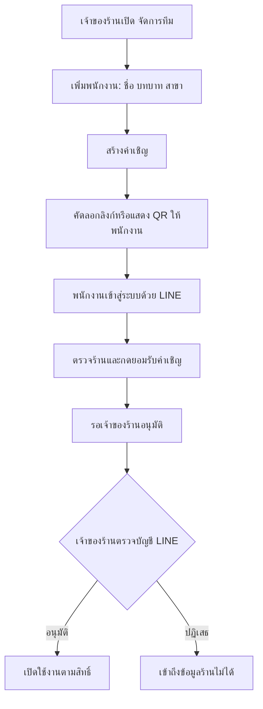

# ขั้นตอนเพิ่มพนักงานร้าน Arisa Rental

สถานะ: พัฒนาระบบตามแบบแล้ว — เมนูจัดการทีม คำเชิญ LINE การอนุมัติ และสิทธิ์ฝั่ง backend พร้อมใช้งานหลัง deploy

ขอบเขตที่ใช้ร่างนี้: เพิ่มพนักงานเข้าใช้หลังบ้าน Alex ของร้าน Arisa Rental ไม่ใช่เพิ่มข้อมูลลูกค้า หรือสร้างบัญชีในระบบ Alex Rental ภายนอก ชื่อร้านอ้างอิงบัญชี LINE OA เดิม `Arisa.Rental`; หากร้านใช้ชื่อแสดงอื่นให้เปลี่ยนข้อความบนหน้าจอโดยไม่เปลี่ยน shop/channel ID

## ระบบเดิมก่อนเพิ่มการจัดการทีม

- LINE Login ตรวจตัวตนแล้วอนุญาตเฉพาะบัญชีใน `ADMIN_LINE_USER_IDS` บนเซิร์ฟเวอร์
- ผู้ใช้ใหม่ที่ยังไม่มีสิทธิ์เห็น LINE user ID เพื่อนำให้ผู้ดูแลเพิ่มในรายการและ deploy ใหม่
- ยังไม่มีหน้าจัดการทีม คำเชิญ บทบาท หรือสถานะรออนุมัติในฐานข้อมูล
- ใช้ขอบเขตร้านและ LINE channel จาก config ของเซิร์ฟเวอร์ หนึ่ง deployment ต่อหนึ่งร้าน/ช่องทาง
- อ่านรายละเอียดเดิมได้ที่ [step-2-admin.md](./step-2-admin.md#เข้าสู่ระบบด้วย-line-login)

## ประสบการณ์ที่เสนอ

เจ้าของร้านเพิ่มพนักงานจากหน้าเว็บได้ พนักงานใช้ LINE ของตนเอง ระบบเก็บว่าใครเพิ่ม ใครอนุมัติ และใครดำเนินการกับข้อมูลร้าน

## ขั้นตอนใช้งาน

### 1. เจ้าของร้านเปิดหน้าจัดการทีม

Desktop: ไอคอนตั้งค่าที่แถบซ้าย → **จัดการทีม**

Mobile: เมนูบัญชี → **จัดการทีม** ไม่เพิ่มแท็บถาวรในแถวลูกค้า/แชท/ออเดอร์

หน้าแรกแสดงรายการทีมด้วยชื่อที่ใช้ทำงาน รูป/ชื่อ LINE บทบาท สาขาที่ทำงาน สถานะ และเข้าใช้ล่าสุด มีตัวกรอง **ทั้งหมด / รอยืนยัน LINE / รออนุมัติ / ใช้งานอยู่ / ระงับสิทธิ์** และปุ่มหลัก **＋ เพิ่มพนักงาน**

แสดงปุ่มยกเลิกคำเชิญหรือระงับสิทธิ์ในเมนูของแต่ละแถว ไม่วางติดกับปุ่มอนุมัติ

### 2. กรอกข้อมูลและเลือกสิทธิ์

ฟอร์มสั้น มีข้อมูลดังนี้:

| ช่อง | รูปแบบและค่าเริ่มต้น |
|---|---|
| ร้าน | Arisa Rental — อ่านอย่างเดียว เซิร์ฟเวอร์กำหนด |
| ชื่อที่ใช้ทำงาน | จำเป็น เช่น พิม ใช้แสดงชื่อผู้ตอบ/ผู้แก้ Note |
| บทบาท | จำเป็น เริ่มที่ **พนักงาน** |
| สาขาที่ทำงาน | เลือกจากสาขาที่บัญชีร้านมีสิทธิ์เท่านั้น; ถ้าร้านมีสาขาเดียวเลือกให้อัตโนมัติ |
| หมายเหตุ | ไม่บังคับ เช่น แอดมินกะบ่าย |

ไม่ต้องให้เจ้าของร้านกรอก LINE ID หรือสร้างรหัสผ่านให้พนักงาน แสดงคำอธิบายสิทธิ์ทันทีเมื่อเลือกบทบาท และคงข้อมูลในฟอร์มเมื่อบันทึกไม่สำเร็จ

ขอบเขตสาขาใช้กับสินค้า ตะกร้า และการสร้างออเดอร์ใน Alex Rental ส่วนแชทของ LINE OA เป็นข้อมูลระดับร้านจนกว่าจะมีระบบมอบหมายบทสนทนาให้สาขา ไม่อ้างว่าการเลือกสาขานี้แยกประวัติแชทได้แล้ว

### 3. สร้างและส่งคำเชิญ

เมื่อกด **สร้างคำเชิญ** แสดงสรุปชื่อ ร้าน บทบาท สาขา และวันหมดอายุ พร้อมปุ่ม **คัดลอกลิงก์** และ **แสดง QR**

ข้อเสนออายุคำเชิญ: 24 ชั่วโมง ใช้กับบัญชี LINE ได้หนึ่งบัญชี เจ้าของร้านส่งลิงก์ให้พนักงานเอง ระบบไม่ส่งข้อความ LINE อัตโนมัติในขั้นตอนนี้

ข้อความสำเร็จ: **สร้างคำเชิญแล้ว ส่งลิงก์นี้ให้พิมเพื่อยืนยันบัญชี LINE**

### 4. พนักงานยืนยันบัญชี LINE

พนักงานเปิดลิงก์ เห็นชื่อร้าน ผู้เชิญ และปุ่ม **ยืนยันตัวตนด้วย LINE** หลัง LINE ยืนยันตัวตนแล้วแสดงรูป/ชื่อบัญชีที่กำลังใช้ พร้อมสรุปบทบาทและสาขา

พนักงานกด **ยอมรับคำเชิญ** หรือเลือก **ใช้ LINE บัญชีอื่น** ก่อนยอมรับ ระบบผูกบัญชีจากตัวตนที่เซิร์ฟเวอร์ตรวจสอบแล้ว ไม่รับ LINE user ID ที่กรอกเอง

ข้อความหลังยอมรับ: **ยืนยันบัญชีแล้ว รอเจ้าของร้านอนุมัติ คุณยังไม่สามารถดูข้อมูลร้านได้**

ถ้ายังไม่ยอมรับ ให้กลับออกจากหน้าได้โดยไม่สร้างสมาชิกที่มีสิทธิ์

### 5. เจ้าของร้านตรวจและอนุมัติ

หน้า **จัดการทีม → รออนุมัติ** แสดงชื่อที่เชิญ รูป/ชื่อ LINE ของผู้รับ บทบาท สาขา ผู้สร้างคำเชิญ และเวลายืนยัน

เจ้าของร้านตรวจว่าเป็นบัญชีของพนักงานที่ต้องการ แล้วกด **อนุมัติให้เข้าร้าน** หากไม่ใช่ให้กด **ปฏิเสธ** และออกคำเชิญใหม่ให้คนที่ถูกต้อง

ลิงก์คำเชิญที่ถูกส่งต่อจึงไม่ทำให้ผู้รับเข้าถึงข้อมูลร้านทันที

ข้อความสำเร็จ: **เพิ่มพิมเข้าร้าน Arisa Rental แล้ว — บทบาทพนักงาน**

### 6. พนักงานเริ่มใช้งาน

หน้ารออนุมัติมีปุ่ม **ตรวจสถานะ** และตรวจซ้ำเมื่อกลับมาที่แท็บ เมื่อได้รับอนุมัติแสดงปุ่ม **เข้าสู่ร้าน Arisa Rental** พร้อมสรุปว่าทำอะไรได้

หลังเข้าใช้งาน แสดงเฉพาะเมนูที่มีสิทธิ์ ตั้งชื่อผู้ตอบและประวัติ Note เป็นชื่อพนักงานคนนั้น ผูก audit กับรหัสบุคคลที่ไม่เปลี่ยนตามชื่อแสดง

ไม่แสดงกล่องขออนุญาตแจ้งเตือนอัตโนมัติ พนักงานเปิดผ่านปุ่มกระดิ่งเองตามความต้องการของอุปกรณ์นั้น

### 7. เปลี่ยนหรือยกเลิกสิทธิ์ภายหลัง

เจ้าของร้านเปลี่ยนชื่อที่ใช้ทำงาน บทบาท และสาขาได้ หากพนักงานออกจากร้านใช้ **ระงับสิทธิ์** เพื่อคงประวัติแชท/Note/ออเดอร์เดิมไว้

คำขอใหม่ต้องตรวจสถานะสมาชิกและสิทธิ์ปัจจุบัน แม้ผู้ใช้นั้นยังมี session เดิม การเปิดใช้งานกลับต้องเป็นคำสั่งของเจ้าของร้านและมีประวัติกำกับ

## บทบาทเริ่มต้นที่เสนอ

| ความสามารถ | เจ้าของร้าน | ผู้จัดการ | พนักงาน |
|---|---|---|---|
| อ่าน/ตอบแชทลูกค้า | ได้ | ได้ | ได้ |
| ตั้งชื่อลูกค้า เพิ่ม/แก้ Note พร้อมประวัติ | ได้ | ได้ | ได้ |
| สรุป เตรียมร่าง เลือกสินค้า เช็คคิว | ได้ | ได้ | ได้ |
| ยืนยันสร้างออเดอร์เข้า Alex Rental | ได้ | ได้ | ไม่ได้ — ส่งให้ผู้จัดการตรวจ |
| เพิ่มคน อนุมัติ เปลี่ยนบทบาท ระงับสิทธิ์ | ได้ | ไม่ได้ | ไม่ได้ |
| เปลี่ยนการเชื่อมต่อร้าน/OA | ได้ | ไม่ได้ | ไม่ได้ |

การเพิ่มพนักงานไม่แสดงตัวเลือกเจ้าของร้าน การโอนความเป็นเจ้าของเป็นขั้นตอนแยก และห้ามระงับสิทธิ์เจ้าของร้านคนสุดท้าย

## สถานะและกรณีผิดปกติ

| เหตุการณ์ | พฤติกรรมที่ต้องได้ |
|---|---|
| สร้างคำเชิญแล้ว | **รอยืนยัน LINE**; ยังไม่มีสิทธิ์เข้าร้าน |
| ยืนยัน LINE และยอมรับแล้ว | **รออนุมัติ**; เห็นได้เฉพาะหน้าสถานะของตน |
| เจ้าของร้านอนุมัติ | **ใช้งานอยู่**; เริ่มสิทธิ์ตามบทบาท/สาขา |
| พักสมาชิก | **ระงับสิทธิ์**; session เดิมเข้าถึงข้อมูลใหม่ไม่ได้ |
| ลิงก์เกิน 24 ชั่วโมงก่อนยอมรับ | **คำเชิญหมดอายุ**; ขอให้เจ้าของร้านสร้างคำเชิญใหม่ |
| เจ้าของร้านยกเลิกคำเชิญ | **คำเชิญถูกยกเลิก**; URL เดิมใช้ต่อไม่ได้ |
| ลิงก์มีผู้ยอมรับแล้ว | บัญชีเดิมเห็นสถานะเดิม; บัญชีอื่นรับต่อไม่ได้ |
| บัญชีนี้เป็นสมาชิกอยู่แล้ว | เปิดข้อมูลสมาชิกเดิมให้ผู้มีสิทธิ์ตรวจ ไม่สร้างสมาชิกซ้ำ |
| เข้าด้วย LINE ผิดบัญชี | มีทางออกเพื่อยืนยันด้วยบัญชีที่ถูกต้องก่อนยอมรับ; หากยอมรับแล้วให้เจ้าของร้านปฏิเสธและออกคำเชิญใหม่ |
| LINE ยืนยันตัวตนไม่สำเร็จ/ยกเลิก | กลับหน้าคำเชิญ อธิบายสาเหตุและลองใหม่ได้ ไม่มีการให้สิทธิ์ |
| สิทธิ์สาขาของบัญชีร้านเปลี่ยน | แจ้งให้ผู้จัดการตรวจสาขาที่ใช้ได้ใหม่ ปฏิเสธการสร้างออเดอร์นอกสิทธิ์ |

คำเชิญที่ยอมรับทันก่อนหมดอายุจะเปลี่ยนเป็นคำขอรออนุมัติ โดย URL รับคำเชิญถูกใช้แล้วทันที คำขอรออนุมัติคงอยู่จนเจ้าของร้านอนุมัติ ปฏิเสธ หรือยกเลิก ไม่ทำให้พนักงานได้สิทธิ์เองเมื่อเวลาผ่านไป

## ขอบเขตการพัฒนาเมื่อนำแบบนี้ไปใช้

- เพิ่มหน้าจัดการทีม หน้ารับคำเชิญ หน้ารอสถานะ และปุ่มจัดการสมาชิก
- เก็บบัญชีบุคคลแยกจากสมาชิกของร้าน โดยสมาชิกมีบทบาท สาขา สถานะ ผู้อนุมัติ และเวลา
- คำเชิญเป็นโทเคนสุ่ม เก็บค่า hash บนเซิร์ฟเวอร์ ไม่ใส่โทเคนจริงใน audit/log และผูกการยอมรับกับบัญชี LINE ที่ยืนยันแล้ว ใช้การอัปเดตแบบ atomic เพื่อกันยอมรับพร้อมกันหลายบัญชี
- ตรวจสิทธิ์ที่ backend ทุก endpoint รวมแชท รูป Note และออเดอร์ การซ่อนปุ่มใน frontend เป็นเพียงการแสดงผล
- ไม่อนุญาตผู้รออนุมัติ ผู้ถูกระงับ หรือผู้ไม่มีสิทธิ์เข้าผ่าน password fallback/shared credential เพื่อข้ามขั้นตอนนี้ ต้องกำหนด principal และสิทธิ์ให้ทุกช่องทางเข้าระบบ
- ย้ายผู้ใช้เดิมจาก whitelist โดยระบุและยืนยันเจ้าของร้านคนแรกอย่างชัดเจนก่อนเปิดระบบ ไม่ให้ผู้สมัครคนแรกกลายเป็นเจ้าของร้านอัตโนมัติ
- หลังย้ายเสร็จ การเพิ่ม/ระงับพนักงานเป็นข้อมูลในฐานข้อมูล ไม่ต้องแก้ `.env` หรือ deploy ทุกครั้ง
- บันทึกผู้กระทำและเวลากับการสร้างคำเชิญ ยอมรับ อนุมัติ ปฏิเสธ เปลี่ยนบทบาท เปลี่ยนสาขา ระงับ และเปิดสิทธิ์กลับ แสดงวันเวลาแบบ `dd/mm/yyyy HH:mm` เขตเวลาไทย
- รักษาพฤติกรรมมือถือเดิม: touch target อย่างน้อย 44px, ช่องกรอกไม่ทำให้ iPhone ซูม, เมนูล่างซ่อนขณะพิมพ์ มีปุ่มย้อนกลับ/ยกเลิกที่ชัดเจน และแสดงข้อผิดพลาดข้างช่องพร้อมรักษาข้อมูลเดิม

สิทธิ์เข้าหลังบ้านนี้แยกจากสิทธิ์ LINE OA Manager และบัญชีผู้ใช้ใน Alex Rental ภายนอก หากพนักงานต้องเข้าเครื่องมือเหล่านั้นโดยตรง ต้องจัดสิทธิ์ในระบบนั้นด้วย การเชื่อมต่อและ API credential ของร้านไม่เปลี่ยนตามพนักงานที่เข้าสู่ระบบ

ข้ออ้างอิง LINE: [Getting started with LINE Login](https://developers.line.biz/en/docs/line-login/getting-started/) และ [Get user IDs](https://developers.line.biz/en/docs/messaging-api/getting-user-ids/) — ใช้ตัวตนที่ LINE ตรวจสอบให้และคง provider/channel ให้ตรงกับระบบเดิม

## เกณฑ์ที่ใช้ตรวจสอบการพัฒนา

1. เจ้าของร้านเพิ่มคำเชิญได้ พนักงาน/ผู้จัดการเพิ่มสิทธิ์ให้ตัวเองหรือผู้อื่นไม่ได้
2. ยอมรับลิงก์อย่างเดียวยังอ่านแชท รูป Note สินค้า หรือตะกร้าของร้านไม่ได้
3. หนึ่งคำเชิญถูกผูกกับหนึ่งบัญชี แม้รับพร้อมกันหลายแท็บ; บัญชีเดิมไม่ถูกสร้างซ้ำ
4. หลังอนุมัติทำงานได้เฉพาะบทบาทและสาขาที่ได้รับ ส่งคำขอโดยตรงเพื่อข้าม UI ก็ถูกปฏิเสธ
5. เจ้าของร้านอนุมัติ/พักสิทธิ์/ปรับบทบาทได้จากเว็บโดยไม่ deploy และ session เดิมต้องใช้ข้ามการพักสิทธิ์ไม่ได้
6. ประวัติเดิมยังระบุผู้กระทำได้หลังเปลี่ยนชื่อหรือระงับพนักงาน และไม่ลบบันทึกงานของผู้ที่ออกจากร้าน
7. ใช้ได้บนมือถือและ desktop โดยไม่เพิ่มภาระกรอกอีเมล LINE ID หรือรหัสผ่านที่ไม่จำเป็น

## การใช้งานหลัง deploy

1. ใช้ `build-all.bat` บน Windows แล้วผู้ใช้ส่งโค้ดและ `dist/` ผ่าน `rungit.bat "Add team invitations and role-based access"` จากนั้น Ubuntu ใช้ `cd ~/alex-connectingpoint` และ `bash ./deploy-all.sh main` ตาม workflow เดิม
2. การเริ่มระบบครั้งแรกจะย้าย LINE user ID ที่มีใน `ADMIN_LINE_USER_IDS` เป็นเจ้าของร้านตามที่ผู้ใช้ยืนยัน เก็บรายชื่อการย้ายใน `team_settings` และไม่ย้ายซ้ำในครั้งต่อไป ไม่เลือกผู้สมัครคนแรกเป็นเจ้าของร้าน
3. เจ้าของร้านเดิมเข้าด้วย LINE ตามปกติ Desktop เปิดไอคอนตั้งค่า → **จัดการทีม**; มือถือใช้ปุ่ม **จัดการทีม** ที่หัวหน้าแชท
4. กด **เพิ่มพนักงาน** เลือกชื่อ บทบาท และสาขา แล้ว **สร้างคำเชิญ** ใช้ปุ่ม **คัดลอกลิงก์** หรือ **แสดง QR**; QR สร้างในเบราว์เซอร์ ไม่ส่งลิงก์ให้ผู้ให้บริการสร้าง QR ภายนอก
5. พนักงานเปิดลิงก์และยืนยัน LINE ก่อนกด **ยอมรับคำเชิญ** ระบบส่งหมายเลข/เวอร์ชันคำเชิญที่กำลังแสดงให้ backend ตรวจด้วย เพื่อกันการรับผิดคำเชิญเมื่อเปิดหลายแท็บ
6. เจ้าของร้านตรวจรูปและชื่อ LINE ในแถว **รออนุมัติ** แล้วกด **ตรวจและอนุมัติ → อนุมัติให้เข้าร้าน** รายชื่ออัปเดตทุก 15 วินาทีขณะเปิดหน้านี้หรือเมื่อกลับมาที่แท็บ และมีปุ่มโหลดข้อมูลล่าสุด
7. ใช้ **แก้ไขสิทธิ์** เพื่อเปลี่ยนบทบาท สาขา หรือระงับ/เปิดสิทธิ์พนักงาน; ปุ่ม **ประวัติ** แสดงผู้กระทำและเวลา ส่วนสิทธิ์เจ้าของร้านไม่ถูกลดหรือระงับผ่านฟอร์มพนักงาน

เมื่อระบบทีมเปิดแล้ว การลบ ID ออกจาก `.env` ไม่ใช่วิธีถอนสิทธิ์สมาชิก ให้ใช้หน้าจัดการทีม รายชื่อใน `.env` มีหน้าที่เริ่มต้นระบบครั้งแรกเท่านั้น การล็อกอินด้วยรหัสผ่านร่วมถูกปิดในโหมดนี้เพื่อให้ทุกงานระบุบุคคลได้ API ภายในที่ใช้ server token ยังคงทำงานแบบ service และไม่มีสิทธิ์จัดการสมาชิกบุคคล

หาก LINE Login channel ยังเป็น Developing พนักงานทั่วไปที่ไม่ได้เป็น Admin/Tester ของ channel จะล็อกอินไม่ได้ ต้องตั้ง LINE Login channel เป็น Published ก่อนใช้งานกับทีมทั่วไป ดู [LINE Developers Console overview](https://developers.line.biz/en/docs/line-developers-console/overview/)

ข้อมูลใหม่ใช้ `admin_accounts`, `team_settings`, `team_memberships` มี index ป้องกันสมาชิกซ้ำ การรับลิงก์และผูกบัญชีเป็น atomic update ใน membership เดียวกัน ประวัติอยู่ในรายการนั้นด้วย ไม่ใช้ TTL ลบสมาชิกหรือประวัติเมื่อคำเชิญหมดอายุ

ลิงก์คำเชิญใช้ fragment `/#invite=...` และย้ายบริบทไป HttpOnly cookie ก่อนเริ่ม LINE Login ไม่ใส่ token ใน query string การแสดงลิงก์ซ้ำทำได้เฉพาะเจ้าของร้านและเฉพาะคำเชิญที่ยังใช้ได้ หากหมุน server token ให้สร้างคำเชิญใหม่แทนการเปิดลิงก์เก่าซ้ำ

การระงับและเปลี่ยนสิทธิ์มีผลกับคำขอใหม่ที่ backend ทันที หน้าเว็บตรวจสถานะ session ทุก 10 วินาทีและเมื่อกลับเข้าแท็บ หากถูกระงับจะออกจากพื้นที่ข้อมูลร้าน งาน AI ที่เข้าคิวเก็บผู้ร้องขอ/เวอร์ชันสิทธิ์และตรวจใหม่ก่อนทำงานและบันทึก คำสั่งภายนอกที่ส่งออกไปแล้วก่อนการระงับยังคงมีประวัติตามผลจริง
