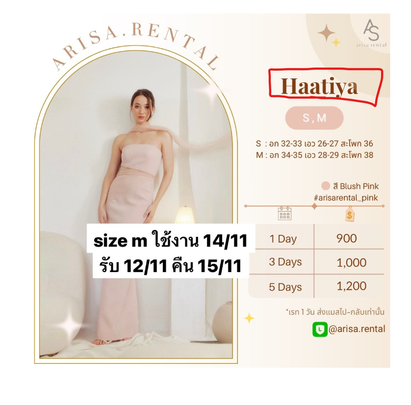
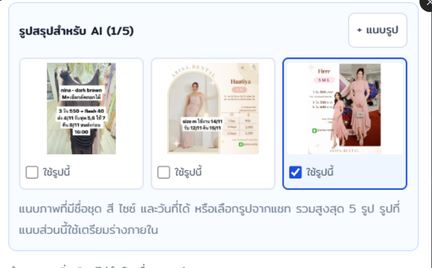

# Requirements

## Functional Requirements

[ภาพตัวอย่าง]
prompts\img-ex1.jpg
prompts\img-ex2.jpg

- มีการเปลี่ยนแปลงการสรุปข้อมูลการเข่าชุด โดยใช้เป็นภาพแทน และเขียนบรรยาายวันที่ เช่า ชื่อชุด สี ไซส์ 

- ถ้า pattern ประมาณ 2 ภาพนี้ สามารถแกะข้อมูลจากภาพ เพื่อ search product เช็คคิว และออกบิลได้หรือไม่

- ในส่วนของ AI ที่สรุปให้แนบรูปได้ 5 รูป 

- ลูกค้า จะเขียนชื่อที่อยู่เบอร์โทร ใน chat ให้ กดค้นหาข้อมูลลูกค้าจาก chat แล้ว fill อัตโนมัติ

- ข้อมูลสินค้า ถ้าแอดมินใส่รูปเองหรือใส่สรุป order เอง AI ไม่ต้องกวาดข้อมูล order หรือ ข้อมูลสินค้าใน chat

- ข้อมูลสินค้าให้เอาข้อมูลที่ extract จาก ภาพ หรือสรุปไปหาใน api https://shop.alexrental.app/api/v2/GetProductItems (อย่าลืม login ก่อน) จากนั้น เอาข้อมูลจาก ที่ได้ fill ให้ครบถาม 

- การบันทึกเบอร์ลูกค้า ไม่มีช่องว่าง ไม่มีชีดกลาง ไม่มี space หน้าหลัง 

- หากไม่ระบุจำนวนให้ default quantity = 1

-  ไม่มีช่องให้ใส่ จำนวน 

- ระบบ Alex สนใจแต่วันรับชุด และวันคืนชุด

- ไม่มีส่วนลดค่าเช่า และส่วนลดค่าประกัน  

- ให้โหลดภาพจาก Alex มาแสดงด้วย 

- ถ้าเป็นรูปแบบด้านบน มีรายละเอียดสินค้า ที่วงสีแดงไว้จะเป็นประเภท ไม่ใช่ชื่อสินค้า 

- วันรับชุด วันคืนชุดไม่ขึ้นทำไม ไม่เอามาใส่ด้วย อาจจะอยู่ในรูป ทำมาเป็นตัวเลือก 

- วิธีรับสินค้า ให้ default เป็น Flash 

- วิธีชำระค่าเช่า และ วิธีชำระค่าประกัน ไมไ่ด้บังครับ ถ้าไม่ขึ้นไม่เลือกให้แสดง [ยังไม่ชำระ]

- หน้า modal ที่ เด้งขึ้นมาให้เลื่อนได้ 

- ค่าส่งถ้ามี ให้บันทึกไว้ที่  note

## UX/UI Requirements

- ทำให้ UI เลื่อนซ้ายขวาได้

- ส่วน section ของ ลูกค้า /  ค้นหาชุดจาก Alex /  ตะกร้าสินค้า (1 ชิ้น) /  วันรับ–คืนชุด / ส่วนลดและค่าจัดส่ง ให้ทำาสี background  อ่อนๆ ให้แยก section ได้

- ปุ่มค้นหาลูกค้าจากแชท ให้อยู่ด้านล่างของฟอร์มลูกค้า 

- ปุ่มค้นหาในหน้านี้ ทำให้เป็นสีสัน โดยใช้สีตาม ธีมใน tailwind

- ตรงรูปสรุปบิล มีปุ่มทำการลบได้ด้วย

## เพิ่มเติม

ตัวอย่าง link ภาพใน alex 
https://shop.alexrental.app/images/8853f673-b4d1-4a5a-848d-f55002f2254b/item/f731bb62-93d9-41f2-8ea3-09fd543c5855.png

หน้า [ร่างล่าสุด]

1 ควรจะมี ตัวกรองเพื่อให้ค้นหาสินค้าจาก Alex  และมีให้เลือก (แสดงภาพเพิ่มเข้ามาด้วย) ให้ค้นหาชุดหรือสินค้าหน้า  [ร่างล่าสุด] ไปเลย  แล้วตัด tab [เลือกชุด] ไปเลย ดูแล้ว งง

2   วันที่รับชุด และวันที่คืนชุด หมายเหตุ ส่วนลดค่าเช่า ส่วนลดค่าประกัน ต่อ 1 order ไม่ใช่ ต่อ 1 สินค้า 

3  ในเช็คคิวในหน้าเดียวกัน [ร่างล่าสุด] 

4 เอา tab [ลูกค้า] ออก

5 เมื่อได้สินค้าแล้ว ให้แสดงแบบตะกร้าสินค้าจะได้ดูได้ง่าย 

6 Header ที่เป็น การ์ดสถิติตามภาพที่ 2 ให้เอาออก

ทำครบทั้ง 5 เรื่องแล้วครับ ทั้งสามข้อแรกที่แจ้ง และอีกสองเรื่องที่แจ้งเพิ่มระหว่างทำ ยังไม่ได้ทดสอบกับรายการสีของร้านจริงหรือส่งบิลจริง

1. วิธีชำระไม่บังคับแล้ว

ตัวเลือกเหมือนในหน้า Alex คือ ยังไม่ชำระ, เงินสด, โอนเงิน, Alipay/wechat, บัตรเครดิต, ช่องทางอื่น
ค่าเริ่มต้นเป็น ยังไม่ชำระ ถ้าส่งมาว่างก็จะเป็นยังไม่ชำระ
2. หน้าต่างใบสรุปเลื่อนได้

ย้ายหน้าต่างออกมาไว้ระดับบนของหน้าเว็บ แถบปิดอยู่ด้านบนตลอด ตัวใบสรุปเลื่อนได้ในตัว และหน้าข้างหลังจะไม่เลื่อนตามขณะเปิด
ใบสรุปสั้นจะสูงพอดีเนื้อหา บนมือถือจะเต็มจอ
ผมทดสอบใน Edge แบบไม่มีหน้าจอแล้วว่าเนื้อหาเลื่อนได้จริง
3. ค่าส่งลงหมายเหตุอัตโนมัติ

ถ้ามีค่าจัดส่ง ระบบจะเขียน "ค่าจัดส่ง 40.00 บาท (ไม่รวมในยอดค่าเช่า)" ต่อท้ายหมายเหตุของออเดอร์ใน Alex เอง ไม่ต้องติ๊กรับทราบแล้ว
4. ลบรูปสรุปสำหรับ AI ได้

มุมรูปแต่ละรูปมีปุ่ม 🗑 ระบบจะถามยืนยันก่อน แล้วลบทั้งไฟล์และรายการ พร้อมเอาออกจากรูปที่เลือกไว้ในสรุป
เหมือนตอนแนบรูปเพิ่ม คือร่างเดิมต้องเตรียมใหม่
5. ค้นสีด้วย code ของร้าน

ช่อง สี เปลี่ยนเป็นตัวเลือกสีของร้านที่ดึงจาก Alex แสดงเป็น "ชมพู (P)" และส่ง code ไปค้น
การ์ดผลค้นหา ตะกร้า และใบสรุป แสดงชื่อสีแทน code ล้วน
ตอนเตรียมร่างด้วย AI ระบบแปลงสีที่เขียนมาเป็น code ก่อนค้น เช่น "Blush Pink" เป็น ชมพู (P) ถ้าตรงได้หลายสี เช่น "dark brown" ที่ร้านมีทั้งน้ำตาลและน้ำตาลเข้ม จะไม่เดาและให้เลือกเอง
ในร่างยังเก็บสีตามที่ลูกค้าเขียนไว้ ส่วน code ใช้แค่ตอนค้น
ร่างที่เตรียมไว้แล้วต้องกดเตรียมออเดอร์ด้วย AI ใหม่ จึงจะค้นด้วย code สี