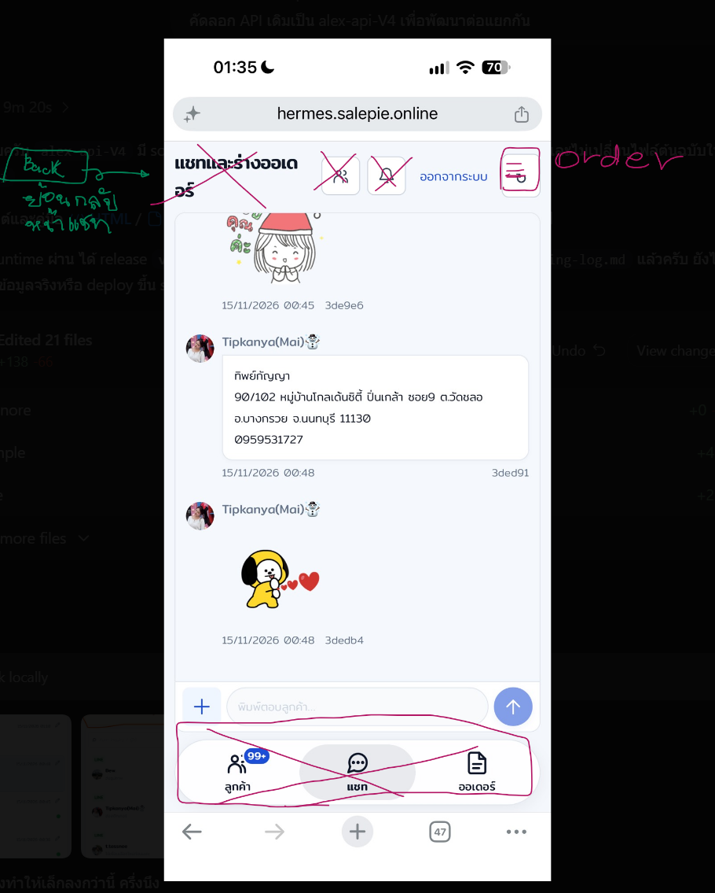

# Requirements

## UX/UI Requirements from users 

- เมนูที่วงทำให้เล็กลงกว่านี้ ครึ่งนึง 
- ตรงตัวอักษร message ให้สีเข้มขึ้นดูชัดกว่านี้ และตัวใหญ่กว่านี้ นิดนึง 
- รูปที่ 2 notification พื้นสีส้ม ไม่ต้องขึ้นมาแล้ว  

- มีการเปลี่ยนแปลง menu ตามภาพที่ 3
- เมนู 1 หน้า home >>> บอกชื่อร้าน เป็นหน้า dasboard 
- เมนู 2 หน้า รายการ chat >>> คือหน้ารายการแชทที่แสดงอยู่ 
- เมนู 3 หน้าจัดการ team >>> คือหน้าที่แสดงการจัดการ staff และ team 

- จากเมนูใหม่หน้า chat เข้าไปแชทของ ลูกค้้าแต่คนตามภาพที่ 4 เมนูด้านล่างไม่ต้องแสดง 
- เมนูด้านบน ให้ icon จัดการ order อยู่ขวาสุด  ถัดมาด้านซ้ายเป็น icon chat กลับไปที่หน้า แชทของลูกค้าคนนั้น  ส่วนซ้ายสุดเป็นปุ่ม back กลับไปหน้ารายการแชท

- chatbox ในคอมพิวเตอร์ laptop หน้าจอใหญ่ เมื่อกด Enter ให้ submit ข้อความเลย แต่ถ้ากด Shift + Enter ให้ขึ้นบรรทัดใหม่
- chatbox ให้ mobile หรือ หน้าจอเล็ก เมื่อกด Enter อย่างเดียวให้ขึ้นบรรทัดใหม่ 

### add-on requirements
- มี quick message สามารถบันทึก message ที่ใช้บ่อยๆ ใช้สำหรับ reply เป็น text 

- สำหรับในช่อง chatbox ถ้าผู้ใช้งานใส่ slash `/` นำคือให้เอา quick message มาตอบ เช่น ถ้ามี quick message `สวัสดีค่ะ ยินดีต้อนรับสู่ Arisa Rental ค่ะ` . . . หากลูกค้าพิมพ์ `/สวัสดี . . . ` ให้มี dropdown เด้งขึ้น น่าจะต้องขึ้นด้านบน suggest quick message ที่ match กับสิ่งที่ user พิมพ์

- มีบันทึก card-based message เป็นรูปสามารถบันทึกได้ ใช้สำหรับ reply เป็นรูปภาพ