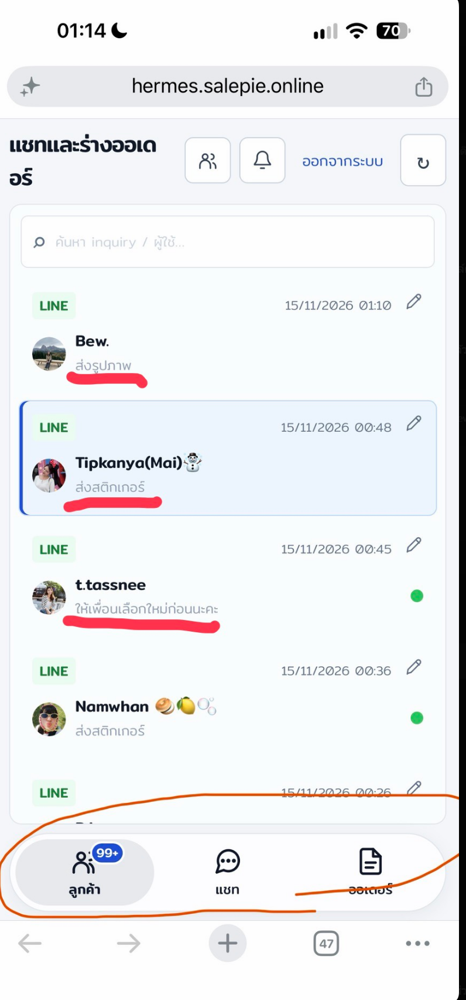
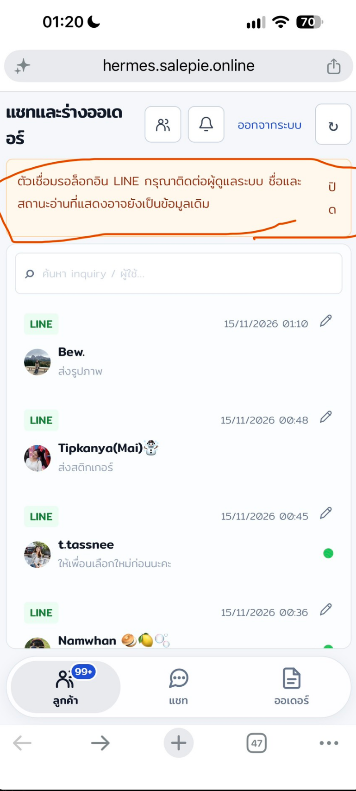
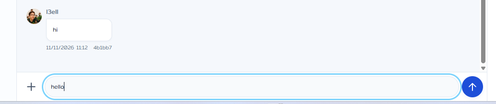
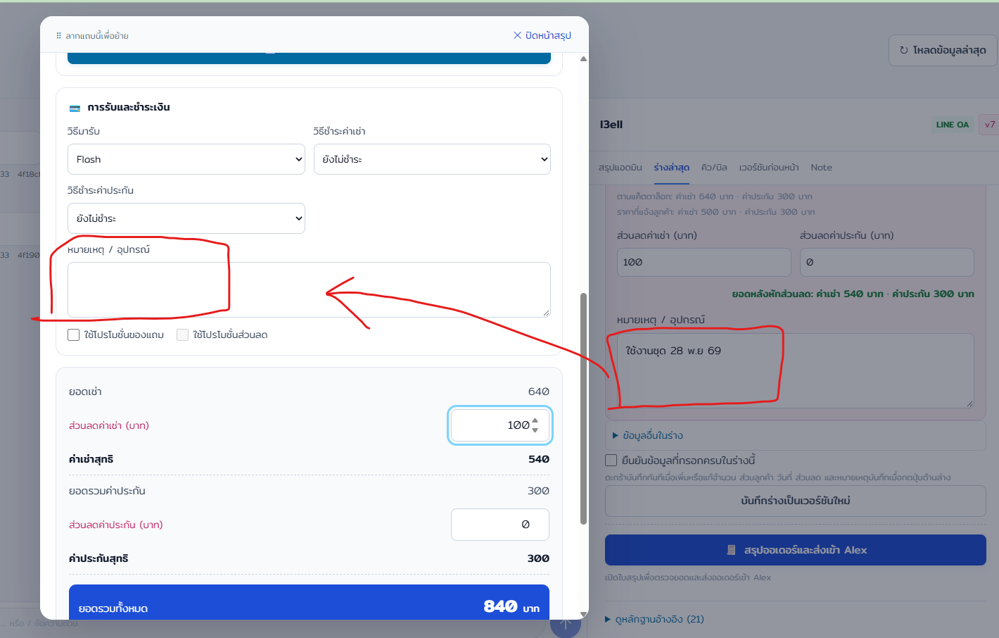

# Requirements

## UX/UI Requirements from users

[Done][17Nov2026 02:16]
- เมนูที่วงทำให้เล็กลงกว่านี้ ครึ่งนึง

[Done][17Nov2026 02:16]
- ตรงตัวอักษร message ให้สีเข้มขึ้นดูชัดกว่านี้ และตัวใหญ่กว่านี้ นิดนึง

[Done][17Nov2026 02:16]
- รูปที่ 2 notification พื้นสีส้ม ไม่ต้องขึ้นมาแล้ว

[Done][17Nov2026 02:16]
- มีการเปลี่ยนแปลง menu ตามภาพที่ 3

[Done][17Nov2026 02:16]
- เมนู 1 หน้า home >>> บอกชื่อร้าน เป็นหน้า dasboard

[Done][17Nov2026 02:16]
- เมนู 2 หน้า รายการ chat >>> คือหน้ารายการแชทที่แสดงอยู่

[Done][17Nov2026 02:16]
- เมนู 3 หน้าจัดการ team >>> คือหน้าที่แสดงการจัดการ staff และ team

[Done][17Nov2026 02:16]
- จากเมนูใหม่หน้า chat เข้าไปแชทของ ลูกค้้าแต่คนตามภาพที่ 4 เมนูด้านล่างไม่ต้องแสดง

[Done][17Nov2026 02:16]
- เมนูด้านบน ให้ icon จัดการ order อยู่ขวาสุด  ถัดมาด้านซ้ายเป็น icon chat กลับไปที่หน้า แชทของลูกค้าคนนั้น  ส่วนซ้ายสุดเป็นปุ่ม back กลับไปหน้ารายการแชท

[Done][17Nov2026 02:16]
- chatbox ในคอมพิวเตอร์ laptop หน้าจอใหญ่ เมื่อกด Enter ให้ submit ข้อความเลย แต่ถ้ากด Shift + Enter ให้ขึ้นบรรทัดใหม่

[Done][17Nov2026 02:16]
- chatbox ให้ mobile หรือ หน้าจอเล็ก เมื่อกด Enter อย่างเดียวให้ขึ้นบรรทัดใหม่

## Requirements related to AI

[Done][16Nov2026 03:22]
- คืนและเก็บ Order ID และ Order Number ที่ Alex ตอบกลับแยกกัน ผูกกับร้าน ลูกค้า บทสนทนา และร่างเวอร์ชันที่ส่งโดยตรง แสดงเลขทั้งสองในผลส่ง ประวัติการส่งและร่าง การติดตามคำขอเดิมได้เลขเดิม ถ้า Alex ยืนยัน Order ID แต่ไม่คืน Order Number ให้แจ้งว่าขาดเลขบิลและไม่ส่งซ้ำ เลขที่ไม่ได้รับเป็น null ไม่เดาหรือใช้แทนกัน

[Done][17Nov2026 02:16]
- ค่าส่งที่เพิ่มเป็นสินค้าอยู่ในออเดอร์เดียวกับค่าเช่า แต่ไม่นำค่าส่งไปเป็นฐานคำนวณส่วนลด และไม่บวกค่าส่งซ้ำ

[Done][17Nov2026 02:16]
- เอา field ข้อมูลค่าส่งแยกออกจากฟอร์มตามที่ผู้ใช้ชี้แจงล่าสุด (แก้จากคำขอเดิมที่ระบุค่าเช่า) คงยอดค่าเช่าและสินค้าค่าขนส่งที่แอดมินเลือกไว้ในออเดอร์

[Done][17Nov2026 02:16]
- หากแอดมินไม่ได้ใส่ ค่าเช่า ค่าประกัน มาให้เอาเป็นราคาจากในระบบเป็นหลัก หลังจากนั้นให้ admin ใส่ส่วนลดค่าเช่า ค่าประกันเอง

[Done][15Nov2026 20:26]
- ช่อง remark ไม่ดึงข้อความจากร่าง AI มาเพิ่มอัตโนมัติ เช่น รายชื่อขนส่ง ข้อสงสัยวันคืน คำสั่งให้แอดมินเลือกสินค้าค่าขนส่ง หรือเวลาในแชท 8:19 หากแอดมินบันทึกหมายเหตุในร่าง ให้ตามไปที่ modal และใช้ค่าที่แอดมินแก้หรือล้างใน modal เป็นอันดับแรก เมื่อไม่มีหมายเหตุที่แอดมินบันทึกจะเริ่มว่าง

[Done][15Nov2026 19:51]
- ในหน้าตรวจสรุปออเดอร์ก่อนส่ง ให้แอดมินแก้ส่วนลดค่าเช่าและค่าประกันได้ ใช้ส่วนลดที่แก้เป็น final รวมถึง 0 และส่งยอดสุทธิที่แก้แล้วเข้า Alex โดยไม่ใช้ยอดเก่าจากร่างทับ ไม่บวกส่วนลดเดิมเพิ่ม และให้แอดมินเลือกสินค้าค่าขนส่งเอง

[Done][16Nov2026 01:54]
- หาก admin แนบ slip โอนเงินของธนาคาร หรือเลือกรูปสลิปให้ AI อ่าน และยอดโอนสำเร็จเป็น THB ต่างจากค่าเช่าสุทธิรวมค่าประกันสุทธิหลังส่วนลดล่าสุดไม่เกิน 100 บาท ให้เติมวิธีชำระค่าเช่าและค่าประกันเป็นโอนเงิน เก็บหลักฐานกับบิล แอดมินเปลี่ยนวิธีชำระเองได้และระบบไม่เขียนทับค่าที่เลือกเอง

### add-on requirements

[Done][15Nov2026 12:38]
- มี quick message สามารถบันทึก message ที่ใช้บ่อยๆ ใช้สำหรับ reply เป็น text

[Done][15Nov2026 12:38]
- สำหรับในช่อง chatbox ถ้าผู้ใช้งานใส่ slash `/` นำคือให้เอา quick message มาตอบ เช่น ถ้ามี quick message `สวัสดีค่ะ ยินดีต้อนรับสู่ Arisa Rental ค่ะ` . . . หากลูกค้าพิมพ์ `/สวัสดี . . . ` ให้มี dropdown เด้งขึ้น น่าจะต้องขึ้นด้านบน suggest quick message ที่ match กับสิ่งที่ user พิมพ์

[Done][15Nov2026 12:38]
- มีบันทึก card-based message เป็นรูปสามารถบันทึกได้ ใช้สำหรับ reply เป็นรูปภาพ

[Done][17Nov2026 02:16]
- ชื่อ tab คิว/บิล เปลี่ยนเป็น "สรุปบิลล่าสุด"

[Done][17Nov2026 02:16]
- tab "สรุปบิลล่าสุด" ควรเอาข้อมูลที่แอดมินเปลี่ยนไว้ ก่อนจะกดส่งเข้า alex

[Done][17Nov2026 02:16]
- ใน tab ร่างล่าสุดเมื่อกด "สรุปออเดอร์และส่งเข้า Alex" จะขึ้น modal สรุปอีกที เมื่อแอดมินกดปุ่ม "ส่งออเดอร์เข้า Alex"

[Done][17Nov2026 02:16]
- ตอนส่งเข้าข้อมูลอย่าให้ข้อมูลหาย แล้วแสดงผลหลังจากส่งเข้า Alex ตามที่กำหนดไว้

## Data transmission to Alex

[Done][17Nov2026 00:32]
- ตอนนี้ หากระบบส่งข้อมูลเข้า alex ไม่สำเร็จ ไม่มีขึ้นเตือน submit เข้าไปก็จะเงียบไป เฉยๆ จงทำให้มี mechanism อะไรบางอย่างที่ ทำให้รู้ว่าส่งสำเร็จ หรือยังไม่สำเร็จ

[Done][17Nov2026 00:32]
- การคืนและเก็บ Order ID/Order Number เพื่อ match ออเดอร์ลูกค้า ใช้ข้อกำหนดที่ทำเสร็จในหัวข้อ Requirements related to AI ด้านบน

## การตรวจสอบระบบบน Server

[Done][15Nov2026 19:25]
- ตรวจแนวทางแจ้งเตือนข้อความใหม่และความจำเป็นของ Firebase — พบ Service Worker บนโดเมนตอบ 404 เพราะ Caddy ส่งผิดบริการ แก้ตัวอย่าง config/ทำคู่มือและเตรียม candidate พร้อม helper ให้ผู้ดูแลใช้ sudo แล้ว ระบบเดิมยังต้องเปิดหน้าเว็บค้างไว้ ยังไม่ได้เพิ่ม PWA หรือ background Web Push

# Need to be fixed

[Done][16Nov2026 01:54]
- แอดมินสรุปก่อนหน้า 100 บาท ตอนกำลังจะส่ง ออเดอร์ทำไมเปลี่ยนกลับมาเป็น 140 บาท ก็บอกว่า ถ้า admin เปลี่ยนเอาที่ แอดมินเปลี่ยนเป็น finalize !!!!

[Done][16Nov2026 01:54]
- ข้อมูลทำไมถึงหายไป ตรง remark

[Done][16Nov2026 03:06]
- เมื่อส่งข้อมูลเข้า Alex ต้องมีข้อความแจ้งผลในหน้าเว็บ ไม่เงียบ: แสดงขั้นตอนระหว่างส่ง ส่งสำเร็จพร้อมเลขออเดอร์ ส่งไม่สำเร็จพร้อมเหตุผลและคงข้อมูลไว้ หรือยังยืนยันไม่ได้พร้อมปุ่มตรวจผล/ติดตามด้วยคำขอเดิม จำคำขอขาดช่วงเมื่อรีเฟรช และไม่ส่งซ้ำอัตโนมัติหรือสร้างรหัสใหม่เมื่อยังไม่รู้ผล
