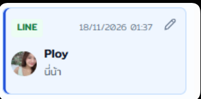
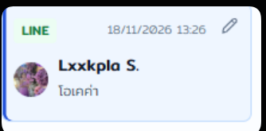
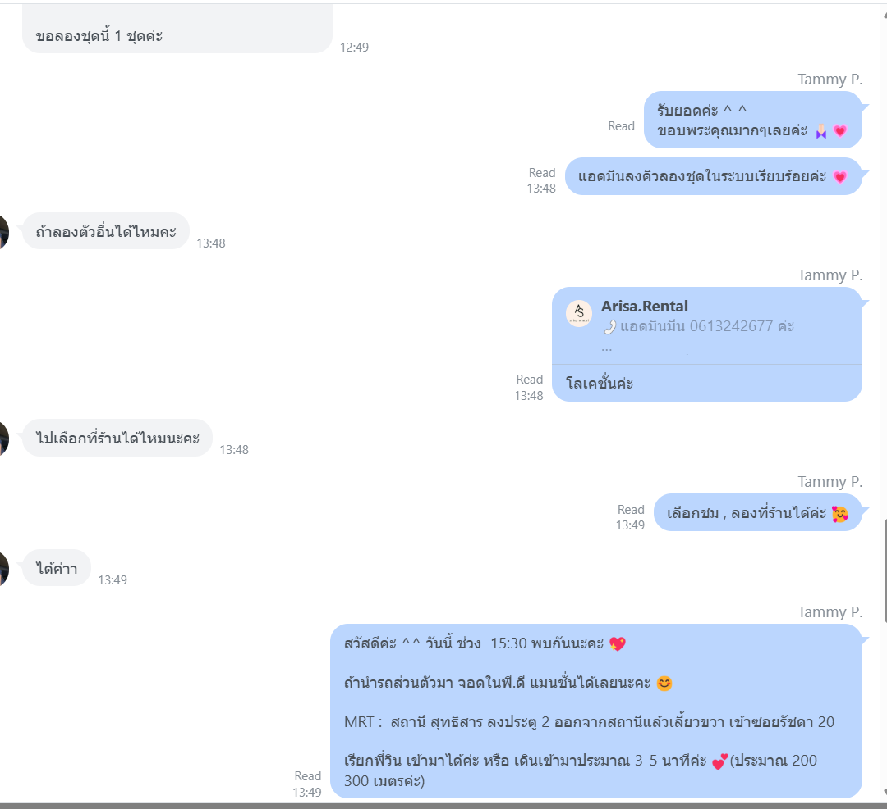
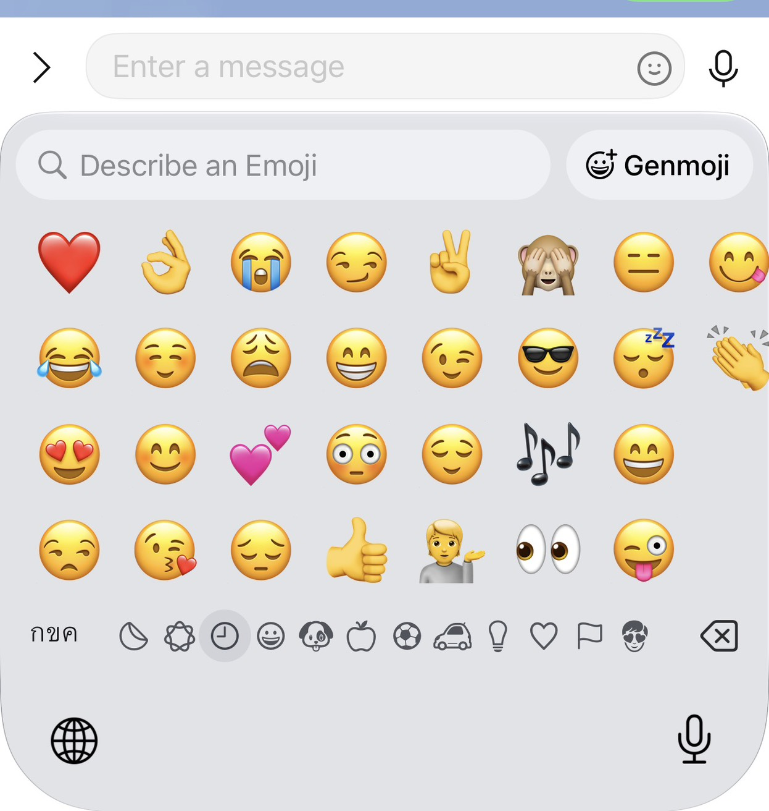
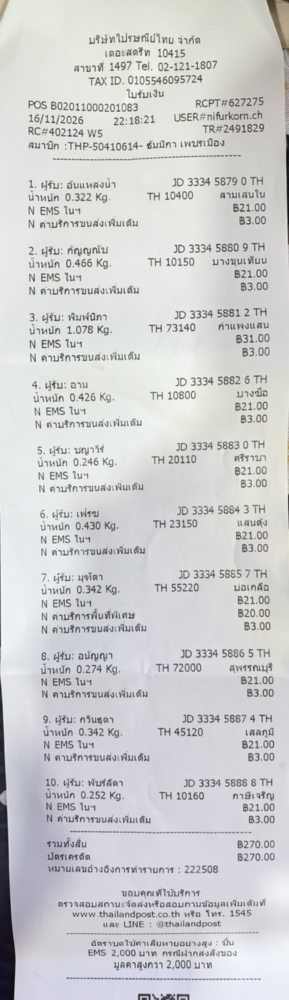
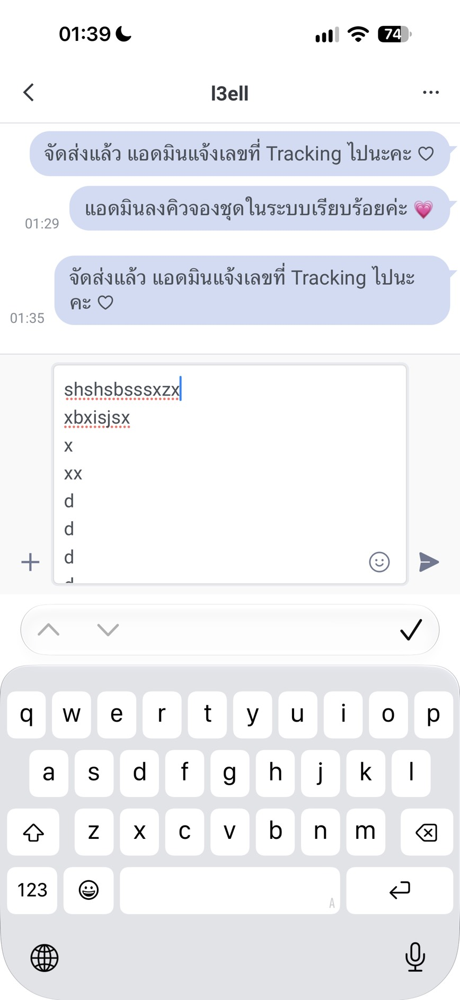

# Requirements

## Functional Requirements 

[Not started]
- เมื่อ user right click หรือใช้ นิ้วกดค้างให้ขึ้น pop up เมนู "ตอบกลับ", copy


### พัสดุและ Tracking batch

[Done][19Nov2026 10:19]
- แก้ปุ่มส่งข้อความที่ถูก disable ในหน้าพัสดุ ให้เลือกแชทลูกค้าแล้วส่ง Tracking ได้แม้บิลยังไม่ยืนยันจาก Alex หรือไม่มี Alex Order ID

> ทำแล้ว: เพิ่มปุ่มเลือกลูกค้าคนนี้ในการ์ดผลค้นชื่อจากบิล/โปรไฟล์/โน้ต เลือกคนที่ตรวจแล้วจึงส่งได้ ไม่เลือกจากชื่อคล้ายอัตโนมัติ Backend รับ inquiry_id เพื่อบันทึกปลายทางแชทโดยไม่บังคับ submission_id ส่วนการเลือกออเดอร์เดิมยังใช้ submission_id และตรวจสาขาตามเดิม ไม่เปลี่ยนสถานะบิล Alex ตรวจร้าน/ช่อง LINE/ผู้รับ/version และคงการล็อกผู้รับกับ LINE retry key หลังเริ่มส่ง ถ้าบันทึกไม่ผ่านจะไม่ส่ง

[Done][19Nov2026 10:19]
- ย่อโซนข้อมูลพัสดุตามภาพ ย้าย Tracking กับรหัสไปรษณีย์ใกล้ช่องค้นหาลูกค้า แสดง EMS ข้างชื่อ เอาช่องค่าขนส่งและบริการออก และเอาข้อความที่ขีดฆ่าเรื่องรอ Alex Order ID ออก

> ทำแล้ว: ไม่มีแบบฟอร์มชื่อผู้รับ/ค่าขนส่ง/บริการแยกซ้ำ เก็บข้อมูลใบเสร็จเดิมไว้ในฐานข้อมูล Tracking กับรหัสไปรษณีย์อยู่ในกรอบเลือกลูกค้าเดียวกัน จอ 320px เรียงลงเพื่อเห็น Tracking ครบ ลิงก์เปิดแชทยังคงเปิดแท็บใหม่ตามลูกค้าที่เลือก ปุ่มบันทึกใช้ข้อความบันทึก Tracking ไว้ก่อน

> ทดสอบผ่าน backend fmt/clippy และ tests 90/90 (unit 56 + MongoDB integration 34 รวมกรณีแชทที่บิลยังไม่ยืนยัน การกันข้ามร้าน ผู้รับไม่ตรง retry คำขอเดิมและการลบ batch); frontend lint/TypeScript/tests 66/66 และ production build; Chrome/WebKit 40 กรณี รวมไม่มีออเดอร์ ชื่อจากโน้ต ชื่อซ้ำ การเปลี่ยนผู้รับที่บันทึกไว้ บันทึกล้มเหลว retry และโหมดเลือกออเดอร์เดิม ตรวจจอ 320/375/1440px ผ่านด้วยระบบจำลอง ไม่ส่ง LINE จริง Linux releases build บน local: backend rel-20261118184728-5b86c66d9921, frontend front-20261118185114-83888a79fc2d รอ Developer ตรวจและ deploy ทั้งสองส่วน ดู docs/shipping-receipts.md


- batch ที่เคย upload แล้ว ให้ลบได้ ทั้ง batch 

- ชื่อที่ได้ให้ map เอาชื่อใน chat ของลูกค้ามา map ไว้ 

 

- ถ้าหาจาก alex sumission customer name หรือจาก ชื่อ Profile ของ user ที่ admin เปลี่ยน แล้ว เอารูปชื่อชื่อ ที่แสดงใน chat 

สุธิดา ดำรงธรรม คนนี้ออกด้วย connecting point  น่าจะมีชื่อจากการออกบิล


[Done][19Nov2026 00:21]
- เพิ่มเติม เรื่อง mapping จากชื่อ alex sumission customer.name หากไม่มี ให้ดูชื่อใน profile, หรือ note ในแชท ว่าแอดมินมีบันทึกหรือไม่

> เพิ่มแล้ว: จับคู่ตามลำดับชื่อในบิล → โปรไฟล์/ชื่อแชท → ข้อความโน้ตปัจจุบันใน customer_notes.text หรือ customer_profiles.notes แสดงชื่อ/รูปแชทเดิมพร้อมข้อความอ้างอิงเมื่อพบในโน้ต ไม่ค้นประวัติแก้ไขหรือชื่อรูปแนบ ไม่เดาชื่อจากคำสะกดใกล้เคียงในโน้ต และไม่แนะนำออเดอร์จากโน้ตอัตโนมัติ ให้แอดมินตรวจและเลือกเอง รายละเอียด docs/shipping-receipts.md

> ทดสอบผ่าน backend 88/88, frontend 66/66 และ browser Chrome/WebKit 20 กรณี Linux releases ทั้งสองส่วน build บน local แล้ว ไม่ส่งข้อความจริง รอ Developer ตรวจ

[Done][19Nov2026 00:36]
- ข้อความที่เตรียมไว้ตามด้านล่าง มีปุ่มให้ส่งข้อความให้กับ ลูกค้าด้านล่าง

```
ส่งของเรียบร้อยค่ะ ✨ (ems)
เลขที่ Tracking: {{เลข tracking จาก ems}}

สามารถเช็คสถานะได้ที่ https://track.thailandpost.co.th
```

> เพิ่มแล้ว: เตรียมข้อความตรงตัวอย่างและเติม Tracking ของพัสดุแต่ละรายการ ปุ่มส่งข้อความให้ลูกค้าคนนี้อยู่ใต้ช่องข้อความ บันทึกข้อมูลปัจจุบันกับออเดอร์ก่อนส่งได้ในคลิกเดียว หรือกดบันทึกไว้ก่อนโดยยังไม่ส่งได้ ข้อความที่เคยแก้/บันทึกยังคงเดิมและมีปุ่มใช้ข้อความมาตรฐาน ถ้าบันทึกไม่สำเร็จจะไม่ส่ง การ retry คำขอที่เริ่มส่งแล้วยังใช้ข้อความ/version เดิม

> ทดสอบ frontend lint/TypeScript/tests 66/66 และ Linux production build ผ่าน Browser Chrome/WebKit 20 กรณีด้วยระบบจำลอง ไม่ส่งข้อความจริง รอ Developer ตรวจ

เปลี่ยนชื่อไฟล์รูป ems ที่ upload ได้

[Done][19Nov2026 00:51]
- ตรง link เปิด chat ให้ เปิด tab browser ใหม่

> ทำแล้ว: ลิงก์เปิดแชททั้ง 3 จุดในหน้าพัสดุ (แชทแนะนำ ผลค้นหาลูกค้า/โน้ต และออเดอร์ที่เลือกหรือบันทึกแล้ว) เปิดแท็บใหม่ด้วย target=_blank พร้อม noopener/noreferrer หน้าพัสดุเดิมและข้อมูลที่กรอกค้างไว้ยังอยู่ ทดสอบ Chrome/WebKit รวม 8 กรณีผ่าน รวมตรวจแชทปลายทางถูกคนและค่าฟอร์มไม่หาย; frontend lint/TypeScript/production build บน local ผ่าน Release: front-20261118175023-246b6342376a รอ Developer ตรวจและ deploy


## UX/UI Requirements from users

[Done][23Nov2026 15:09]
- วางรูปที่คัดลอกลงช่องตอบแชทได้ด้วย Ctrl+V หรือคลิกขวา → Paste แสดงตัวอย่างก่อนกดส่งรูป โดยไม่ส่งอัตโนมัติและคงข้อความร่างเดิม

> ทำแล้ว: รับไฟล์รูปจาก paste event ในช่องตอบแชท ใช้ขั้นตอนย่อ/อัปโหลดและแสดงตัวอย่างเดิม รองรับ JPG/PNG/WEBP/GIF ไม่เกิน 40 MB ครั้งละ 1 รูป ไม่วาง URL/HTML ที่ติดมากับรูปแทนข้อความ ไม่อ่าน Clipboard นอกจังหวะวางและไม่ขอ permission เพิ่ม กันวางซ้ำระหว่างเตรียม/ส่งรูป และคงรูปเดิมเมื่ออัปโหลดรูปใหม่ไม่สำเร็จ

> ทดสอบ frontend 73/73, lint/TypeScript และ Linux production build ผ่านบน local; Chrome/WebKit 6 กรณีที่ 1440/375/320px ผ่าน โดย Chrome desktop ตรวจ Ctrl+V จริงสำหรับรูป/ข้อความ ส่วนเส้นทางเมนู Paste ตรวจผ่าน ClipboardEvent จำลอง ครอบคลุมตัวอย่าง ยกเลิก ส่ง/retry ด้วย request ID เดิม การวางซ้ำ หลายรูป ชนิด/ขนาดไม่รองรับ อัปโหลดผิดพลาด แนบไฟล์เดิม เปลี่ยนลูกค้าระหว่างอัปโหลด และแชทที่ตอบไม่ได้ ไม่ส่งข้อความจริง ตรวจ checksum release 2,101 ไฟล์ตรง manifest Release: front-20261123080546-5ffcce1a4958 รอ Developer ตรวจและ deploy

[Done][19Nov2026 00:47]
- ตัวอักษร ทั้งจอเล็ก จอใหญ่ ขยาย size ขึ้น +1px


[Done][19Nov2026 00:47]
- ใช้ตัวอักษรมีหัวแทน Mitr ใช้เป็น font ที่อยู่ใน LINE OA ตามรูปที่แนบ

> ทำแล้ว: เปลี่ยนเป็น Noto Sans Thai Looped ตัวไทยมีหัวให้ใกล้เคียงภาพ LINE OA (ยังไม่ได้ยืนยันชื่อฟอนต์จริงของ LINE) โหลดผ่าน next/font และให้บริการไฟล์ฟอนต์จากแอป เพิ่มขนาด font-size เดิม 327 จุดอีก 1px คงส่วนเพิ่มสำหรับมือถือเดิมไว้ จึงเพิ่มขึ้น 1px ทั้งสองขนาดจอ รวมข้อความในแชท แบบฟอร์ม ปุ่ม เวลา และ placeholder

> ทดสอบผ่าน frontend lint, tests 66/66 และ Linux production build บน local; Chrome/WebKit 42 กรณีที่ 320/375/1440px เปรียบเทียบขนาดก่อน–หลัง 1,098 จุดเพิ่มตรง 1px ไม่ล้นแนวนอน และหน้าพัสดุ 20 กรณีผ่านด้วยระบบจำลอง Release: front-20261118174607-27c34d295ce8 รอ Developer ตรวจและ deploy


[Done][23Nov2026 14:56]
- ต้องการ set emoji ทั้งหมดเมื่อใช้ใน Laptop เหมือนกับใน มือถือ
- แก้บั๊กเมื่อเลื่อนลงดูอีโมจิแล้วรายการเด้งกลับด้านบนระหว่างหน้าแชทอัปเดตอัตโนมัติ

> เพิ่มแล้ว: ปุ่มหน้ายิ้มข้างช่องตอบลูกค้าเปิดแผงอีโมจิทั้ง Laptop และมือถือ ค้นหาภาษาไทย แบ่งหมวด เลือกสีผิว และใช้รายการล่าสุด มี 1,906 รายการหลัก รวมรูปแบบ/สีผิวเป็น 3,931 รายการ ใช้ภาพ Twemoji ชุดเดียวกันในแผง เลือกหลายตัวต่อกันตรงเคอร์เซอร์หรือแทนข้อความที่เลือกได้ ปิดด้วย Esc/ปุ่มปิด/คลิกนอกแผงโดยข้อความยังอยู่ การเลือกไม่ส่ง LINE จนกดส่ง ข้อความที่ส่งเป็น Unicode จึงแสดงรูปร่างตามอุปกรณ์ของลูกค้า ส่วน Genmoji เป็นรูปจาก iPhone ที่ใช้เครื่องมือแนบรูปเดิมได้ ดู docs/chat-emoji-picker.md

> ทดสอบ frontend lint/TypeScript/tests 69/69 และ Linux production build ผ่านบน local; ตรวจรายการภาพครบ 3,931/3,931; browser Chrome/WebKit 16 กรณี (แผง emoji 8 + composer เดิม 8) ที่ 320/375/1024/1440px รวมค้นหาภาษาไทย หมวด ธง สีผิว เคอร์เซอร์ ข้อความที่เลือก ปิดแผง คีย์บอร์ดมือถือ ข้อความด่วน เปลี่ยนลูกค้า และการส่ง/retry เดิม ด้วย API จำลอง ไม่ส่งข้อความจริง Release: front-20261119065638-db1ca6ed5787 รอ Developer ตรวจและ deploy

> แก้บั๊ก 23Nov2026 14:56: ใช้ตัวโหลดชุดข้อมูลภาษาไทยตัวเดิมทุกครั้งที่ render เพื่อไม่ให้การอัปเดตแชทหรือการเลือกอีโมจิทำให้รายการว่างชั่วคราวและรีเซ็ต scroll กลับด้านบน ยืนยันรุ่นเดิมล้มเมื่อแชทอัปเดต (scrollTop 2200 → 0) และรุ่นแก้คง 2200; frontend lint/TypeScript/tests 70/70 และ Linux production build ผ่านบน local; Chrome/WebKit 6 กรณีที่ 1440/375/320px ผ่าน รวมเลือกอีโมจิ ค้นหา เปลี่ยนหมวด คีย์บอร์ด และ Esc โดยไม่ส่งข้อความจริง ตรวจ checksum release 2,101 ไฟล์ตรง manifest Release: front-20261123075423-2ddd589f70c6 รอ Developer ตรวจและ deploy


## Requirements related to AI

ตัวอย่าง ใบเสร็จส่งของไปรษณีย์ไทย 



[Done][17Nov2026 01:39]
- เพิ่มอีก 1 เมนูสำหรับแอดมิน เพื่ออัพโหลดบิลที่มี Tracking ค่าขนส่ง upload รูปภาพ ให้อ่านและ extrack ข้อมูลออกมา
ในใบเสร็จจะมี ชื่อลูกค้า และ เลข tracking อยู่ให้ save เลข tracking ให้ตรงกับ order โดยแต่ละ Order จะมีชื่อลูกค้าที่ตรงกับ tracking 
ให้ save เลข tracking ไว้เตรียมส่งให้กับ ลูกค้า 

[Done][17Nov2026 01:39]
- เมื่อได้เลข tracking มาแล้ว ให้ match กับชื่อ และแชทของลูกค้าแต่ละคน ขึ้นชื่อและหน้าของลูกค้าแบบใน chat แต่ละคนก่อนเพื่อให้แอดมินตรวจ และกดส่ง


[Not started]
- สำหรับการจองคิวเข้ามาในร้าน ต่อกับ Google Calendar ***

[Done][17Nov2026 02:39]
- ปุ่ม Favorite ของสินค้าเป็นรูปดาว ให้แอดมินร้าน add favorite ตอนค้าหาสินค้าจาก alex ได้เลย ให้ทำเป็น list ไว้ใกล้ๆ มือเพื่อจะได้ click add ลงตะกร้าได้สะดวก 

> ทำแล้ว: กดดาวบนผลค้นหา/สินค้าแนะนำเพื่อเก็บหรือนำออก รายการโปรดพร้อมรูปและตัวกรองอยู่ในหน้าค้นหา ใช้ร่วมกันในร้านแยกตามช่อง LINE/สาขา คงอยู่หลังรีเฟรชหรือเปลี่ยนลูกค้า กดบวกเพิ่มลงตะกร้าลูกค้าที่เลือกโดยตรวจ product ID และราคาล่าสุดจาก Alex ดู `docs/product-favorites.md` ทดสอบ backend รวม 82 ข้อและ browser Chrome/WebKit 6 กรณีผ่านด้วยระบบจำลอง

> ตรวจซ้ำ 18Nov2026 17:52 หลังผู้ใช้แจ้งไม่เห็นดาว: server ส่ง JavaScript/CSS ตรงกับ release ล่าสุดและมีปุ่มดาว ตรวจ API รายการโปรดจริงผ่าน ทดสอบ assets จากโดเมนจริงกับการ์ดสินค้ามีรูป/อยู่ในตะกร้าแล้วผ่าน Chrome/WebKit 4 กรณี ปุ่มไม่ถูกบัง แนะนำให้บันทึกร่างแล้วโหลดหน้าใหม่เพื่อรับ assets ล่าสุด ยังต้องตรวจแท็บของผู้ใช้ต่อหากหลังโหลดใหม่ยังไม่เห็นปุ่ม ดูขั้นตอนในเอกสารเดิม

``` 
[Booking เข้ามาลองชุด] 1 ท่าน : คุณ
(1 ท่าน : 100 บาทค่ะ)

 เวลา    น. 

✅ ยอดรวมชำระ   บาทค่ะ 

✔️ ค่าลองชุดสามารถนำมาลบกับค่าเช่าชุดได้ค่ะ

✔️ หากลองแล้วไม่รับชุด สามารถนำค่าลองชุดมาหักกับค่าเช่าชุดภายหลังได้ค่ะ

🔺 รบกวนชำระเงินภายใน 1 ชั่วโมง หลังได้รับแจ้งค่ะ 
หากเลย 1 ชม. รบกวนเช็คคิวลองชุดอีกครั้งนะคะ🔺

ขอบพระคุณมากๆเลยค่ะ (hands together)(sparkling heart)
``` 

## Need to be fixed


[Not started]
- ทำไมยืนยันผลการส่งไม่ได้ครับ alex เวลาออกบิลแล้ว ไม่ให้ข้อมูล Order ID กลับมาเหรอ ต้องแก้ที่ Alex หรือไม่ หรือแก้ที่ MCP วิเคราะห์ สาเหตุ

> ข้อนี้รอตรวจผลตอบกลับจาก Alex จริงของกรณีในภาพ ส่วนกลไกแจ้งผลและเก็บ Order ID/Order Number พัฒนาและทดสอบด้วย Alex จำลองแล้วตาม `requirements-v0.2.md` หัวข้อ Data transmission to Alex ยังไม่ถือว่าแก้สาเหตุในภาพนี้แล้ว




[Done][17Nov2026 01:57]
- กล่องข้อความหากม้ข้อความมากกว่า 1 บรรทัด ให้กล่องข้อความขยายความสูงขึ้นได้เหมือนในภาพแสดงข้อมูล 8 บรรทัด เมื่อ user กดที่ ข้อความ หรือกดส่ง
ให้กล่องข้อความกลับมาแสดงเหลือ 1 บรรทัด

## การติดตามงาน

[Done][17Nov2026 09:36]
- แก้ข้อความล่าสุดบางแชทมาไม่ครบ: เปิดแชทจากข้อความล่าสุด รองรับข้อความใหม่เกิน 200 รายการ โหลดเก่าย้อนขึ้นโดยไม่กระโดด คงประวัติ/ข้อความที่กำลังพิมพ์ ไม่ให้คำขอของลูกค้าคนเก่าทับคนใหม่ และไม่หยุดอ่านข้อความลูกค้าเมื่อการตรวจ OA ขัดข้อง

> พัฒนาและทดสอบ local แล้ว: backend 83 ข้อ, frontend 63 ข้อ, Chrome/WebKit 6 กรณี ผ่าน พร้อม Linux releases ดู `docs/chat-history-sync.md` ตรวจ server พบ LINE webhook เปิดอยู่และไม่มีงาน webhook ค้าง/ล้มเหลว แต่ OA connector ยัง NEEDS_LOGIN ต้องลงชื่อเข้าใหม่และ deploy release นี้ ยังรอชื่อ/เวลาตัวอย่างเพื่อระบุสาเหตุของข้อความที่หายจริงเฉพาะรายการ

[Done][17Nov2026 02:16]
- หลังพัฒนาและทดสอบแต่ละ item เสร็จ ให้ใส่สถานะ Done พร้อมวันเวลาเหนือ item ใน requirement files ให้ตรงกับงานจริง คงรายการที่ยังไม่ทำเป็น Not started และให้ผู้ใช้เป็นผู้เปลี่ยนเป็น Reviewed
