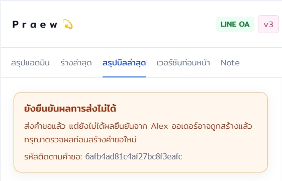

# Requirements

## Functional Requirements 

[Not started]
- เมื่อ user right click หรือใช้ นิ้วกดค้างให้ขึ้น pop up เมนู "ตอบกลับ", copy


### พัสดุและ Tracking batch

[Done][18Nov2026 23:10]
- batch ที่เคย upload แล้ว ให้ลบได้ ทั้ง batch

> เพิ่มปุ่มลบทั้ง batch พร้อมยืนยัน ลบใบเสร็จและพัสดุทุกรายการออกจากการใช้งาน ใช้ได้ทุกสถานะ เก็บประวัติการส่งภายในเพื่อป้องกันส่งซ้ำ ไม่ลบออเดอร์หรือข้อความแชท ตรวจสิทธิ์ทุกสาขาที่ผูกและกันการลบระหว่างบันทึก/ส่ง ดู `docs/shipping-receipts.md`

[Done][18Nov2026 23:48]
- เมื่อได้เลข tracking มาแล้ว ให้ match กับชื่อ และแชทของลูกค้าแต่ละคน ขึ้นชื่อและหน้าของลูกค้าแบบใน chat แต่ละคนก่อนเพื่อให้แอดมินตรวจ และกดส่ง โดยชื่อที่ได้ให้ map กับชื่อใน chat ของลูกค้าไว้ ค้นจาก `alex_submissions.customer.name` หรือชื่อในโปรไฟล์ลูกค้าที่แอดมินแก้ (`customer_profiles.display_name`) แล้วแสดงชื่อ/รูปเดียวกับแชทเดิม

> ค้นชื่อจากประวัติบิลทุกสถานะ (รองรับฟิลด์ชื่อรุ่นเก่า) โปรไฟล์ลูกค้าที่แอดมินแก้ LINE/OA และชื่อที่ตั้งในแชท โดยแสดงชื่อ/รูปปัจจุบันจากแชทตาม LINE user/inquiry ที่ตรวจตรงกัน ไม่เอาชื่อในบิลไปแทนชื่อแชท เพิ่มการ์ดลูกค้าที่พบแม้บิลยัง SUBMIT_UNKNOWN/ไม่มี Alex Order ID พร้อมเปิดแชทและข้อความตรวจเลขออเดอร์ การ์ดนี้ไม่ใช่ออเดอร์ที่พร้อมผูก Tracking ยังต้องเลือกออเดอร์ CONFIRMED พร้อม ID ก่อนบันทึก/ส่ง ชื่อซ้ำรวมคนที่บิลยังไม่ยืนยันหรือผลค้นไม่ครบไม่เลือกให้เอง ค้นชื่อแชท/โปรไฟล์เพื่อเจอออเดอร์เก่านอก 1,000 รายการล่าสุดได้ รายละเอียด `docs/shipping-receipts.md`

> การทดสอบรอบนี้: backend 86/86, frontend 65/65, browser Chrome/WebKit กรณีจับคู่บิล/โปรไฟล์ 12 กรณีและ regression ลบ batch 16 กรณีผ่านด้วยระบบจำลอง ตรวจกรณีผู้ใช้ระบุด้วย GET จริงพบชื่อในร่าง SENT แต่ submission ยัง SUBMIT_UNKNOWN ไม่มีเลขออเดอร์ ไม่แก้บิลหรือส่งข้อความจริง Linux release ทั้งสองส่วน build บน local แล้ว รอ Developer ตรวจ

## UX/UI Requirements from users


## Requirements related to AI

ตัวอย่าง ใบเสร็จส่งของไปรษณีย์ไทย 


[Done][17Nov2026 01:39]
- เพิ่มอีก 1 เมนูสำหรับแอดมิน เพื่ออัพโหลดบิลที่มี Tracking ค่าขนส่ง upload รูปภาพ ให้อ่านและ extrack ข้อมูลออกมา
ในใบเสร็จจะมี ชื่อลูกค้า และ เลข tracking อยู่ให้ save เลข tracking ให้ตรงกับ order โดยแต่ละ Order จะมีชื่อลูกค้าที่ตรงกับ tracking 
ให้ save เลข tracking ไว้เตรียมส่งให้กับ ลูกค้า 


[Not started]
- สำหรับการจองคิวเข้ามาในร้าน ต่อกับ Google Calendar ***

[Done][17Nov2026 02:39]
- ปุ่ม Favorite ของสินค้าเป็นรูปดาว ให้แอดมินร้าน add favorite ตอนค้าหาสินค้าจาก alex ได้เลย ให้ทำเป็น list ไว้ใกล้ๆ มือเพื่อจะได้ click add ลงตะกร้าได้สะดวก 

> ทำแล้ว: กดดาวบนผลค้นหา/สินค้าแนะนำเพื่อเก็บหรือนำออก รายการโปรดพร้อมรูปและตัวกรองอยู่ในหน้าค้นหา ใช้ร่วมกันในร้านแยกตามช่อง LINE/สาขา คงอยู่หลังรีเฟรชหรือเปลี่ยนลูกค้า กดบวกเพิ่มลงตะกร้าลูกค้าที่เลือกโดยตรวจ product ID และราคาล่าสุดจาก Alex ดู `docs/product-favorites.md` ทดสอบ backend รวม 82 ข้อและ browser Chrome/WebKit 6 กรณีผ่านด้วยระบบจำลอง

> ตรวจซ้ำ 18Nov2026 17:52 หลังผู้ใช้แจ้งไม่เห็นดาว: server ส่ง JavaScript/CSS ตรงกับ release ล่าสุดและมีปุ่มดาว ตรวจ API รายการโปรดจริงผ่าน ทดสอบ assets จากโดเมนจริงกับการ์ดสินค้ามีรูป/อยู่ในตะกร้าแล้วผ่าน Chrome/WebKit 4 กรณี ปุ่มไม่ถูกบัง แนะนำให้บันทึกร่างแล้วโหลดหน้าใหม่เพื่อรับ assets ล่าสุด ยังต้องตรวจแท็บของผู้ใช้ต่อหากหลังโหลดใหม่ยังไม่เห็นปุ่ม ดูขั้นตอนในเอกสารเดิม

``` 
[Booking เข้ามาลองชุด] 1 ท่าน : คุณ
(1 ท่าน : 100 บาทค่ะ)

 เวลา    น. 

✅ ยอดรวมชำระ   บาทค่ะ 

✔️ ค่าลองชุดสามารถนำมาลบกับค่าเช่าชุดได้ค่ะ

✔️ หากลองแล้วไม่รับชุด สามารถนำค่าลองชุดมาหักกับค่าเช่าชุดภายหลังได้ค่ะ

🔺 รบกวนชำระเงินภายใน 1 ชั่วโมง หลังได้รับแจ้งค่ะ 
หากเลย 1 ชม. รบกวนเช็คคิวลองชุดอีกครั้งนะคะ🔺

ขอบพระคุณมากๆเลยค่ะ (hands together)(sparkling heart)
``` 

## Need to be fixed



[Not started]
- ทำไมยืนยันผลการส่งไม่ได้ครับ alex เวลาออกบิลแล้ว ไม่ให้ข้อมูล Order ID กลับมาเหรอ ต้องแก้ที่ Alex หรือไม่ หรือแก้ที่ MCP วิเคราะห์ สาเหตุ

> ข้อนี้รอตรวจผลตอบกลับจาก Alex จริงของกรณีในภาพ ส่วนกลไกแจ้งผลและเก็บ Order ID/Order Number พัฒนาและทดสอบด้วย Alex จำลองแล้วตาม `requirements-v0.2.md` หัวข้อ Data transmission to Alex ยังไม่ถือว่าแก้สาเหตุในภาพนี้แล้ว


[Done][17Nov2026 01:57]
- กล่องข้อความหากม้ข้อความมากกว่า 1 บรรทัด ให้กล่องข้อความขยายความสูงขึ้นได้เหมือนในภาพแสดงข้อมูล 8 บรรทัด เมื่อ user กดที่ ข้อความ หรือกดส่ง
ให้กล่องข้อความกลับมาแสดงเหลือ 1 บรรทัด

## การติดตามงาน

[Done][17Nov2026 09:36]
- แก้ข้อความล่าสุดบางแชทมาไม่ครบ: เปิดแชทจากข้อความล่าสุด รองรับข้อความใหม่เกิน 200 รายการ โหลดเก่าย้อนขึ้นโดยไม่กระโดด คงประวัติ/ข้อความที่กำลังพิมพ์ ไม่ให้คำขอของลูกค้าคนเก่าทับคนใหม่ และไม่หยุดอ่านข้อความลูกค้าเมื่อการตรวจ OA ขัดข้อง

> พัฒนาและทดสอบ local แล้ว: backend 83 ข้อ, frontend 63 ข้อ, Chrome/WebKit 6 กรณี ผ่าน พร้อม Linux releases ดู `docs/chat-history-sync.md` ตรวจ server พบ LINE webhook เปิดอยู่และไม่มีงาน webhook ค้าง/ล้มเหลว แต่ OA connector ยัง NEEDS_LOGIN ต้องลงชื่อเข้าใหม่และ deploy release นี้ ยังรอชื่อ/เวลาตัวอย่างเพื่อระบุสาเหตุของข้อความที่หายจริงเฉพาะรายการ

[Done][17Nov2026 02:16]
- หลังพัฒนาและทดสอบแต่ละ item เสร็จ ให้ใส่สถานะ Done พร้อมวันเวลาเหนือ item ใน requirement files ให้ตรงกับงานจริง คงรายการที่ยังไม่ทำเป็น Not started และให้ผู้ใช้เป็นผู้เปลี่ยนเป็น Reviewed
